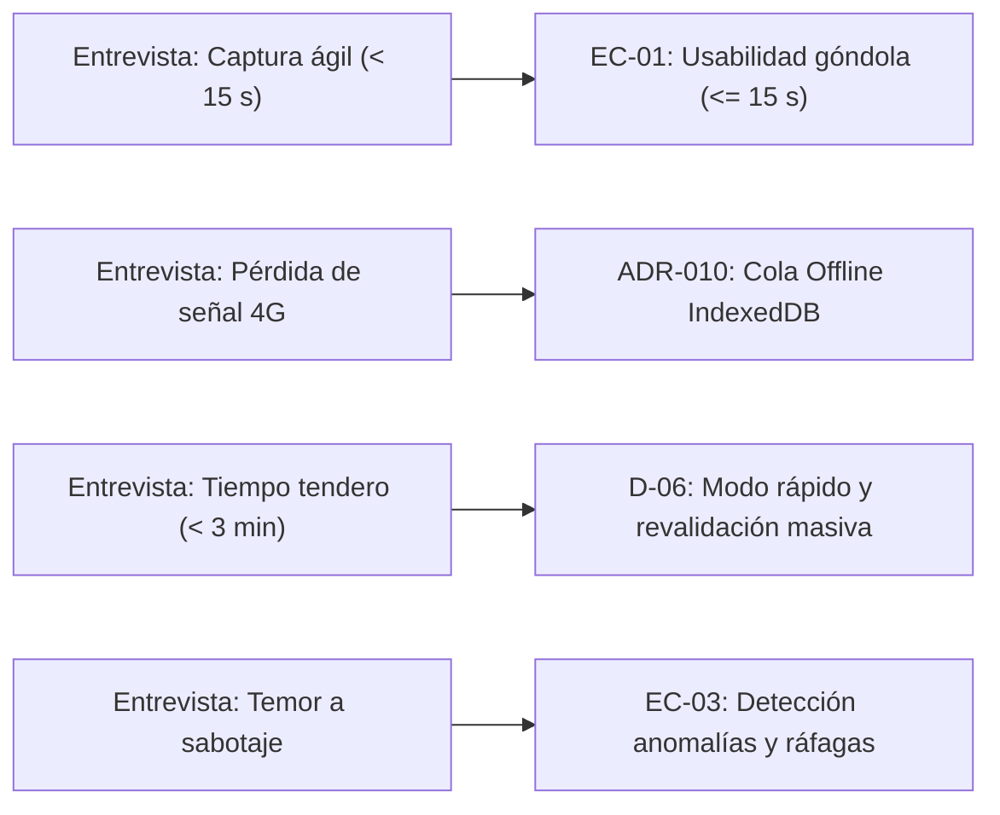

# Entregable 1: Instrumento y Hallazgos de Validación de Campo con Consumidores y Tiendas de Barrio (Armenia, Quindío)

## 1. Ficha Técnica y Objetivo del Estudio
- **Propósito:** Levantar requerimientos reales de usabilidad, hábitos de compra y barreras tecnológicas en el municipio de Armenia (Quindío) para fundamentar las decisiones arquitectónicas del núcleo del comparador.
- **Población objetivo:** Consumidores responsables de compras del hogar en estratos 2, 3 y 4 de Armenia, y tenderos de barrio tradicionales del sector céntrico y barrial (Comuna 1 y Comuna 7).
- **Muestra aplicada:** 12 consumidores urbanos y 3 propietarios/administradores de tiendas de barrio y minimercados.
- **Fecha de aplicación:** Noviembre de 2026.
- **Responsables:** Equipo de Ingeniería (Rol A, B, C y D).

---

## 2. Instrumento de Validación Aplicado

### Bloque A: Consumidores y Familias
1. *¿Con qué frecuencia realiza compras de la canasta familiar y en cuántos lugares distintos?*
2. *¿Compara activamente precios entre supermercados de cadena (Éxito, Olímpica, D1, Ara) y tiendas de barrio? ¿Cómo lo hace actualmente?*
3. *En caso de usar una app web en el teléfono mientras merca frente a la góndola, ¿cuánto es el tiempo máximo que estaría dispuesto a invertir para registrar un precio?*
4. *¿Qué problemas de conectividad móvil experimenta al interior de supermercados y minimercados en Armenia?*
5. *¿Qué le genera mayor desconfianza al ver un precio publicado en internet?*

### Bloque B: Propietarios de Tiendas de Barrio
1. *¿Con qué frecuencia modifica los precios de venta al público en productos de alta rotación (arroz, leche, huevos, aceite)?*
2. *¿Estaría dispuesto a publicar sus precios oficiales en una plataforma digital comunitaria si no tiene costo?*
3. *¿Cuánto tiempo al día dispone para actualizar precios en una pantalla digital?*
4. *¿Qué temores tiene frente a que consumidores o competidores reporten precios erróneos de su local?*

---

## 3. Tabulación y Síntesis de Hallazgos

| Dimensión Analizada | Hallazgo Cualitativo y Cuantitativo | Implicación Técnica en el Comparador |
| :--- | :--- | :--- |
| **Tiempo de captura en góndola** | 10 de 12 consumidores indicaron que abandonarían la captura si requiere más de **15 a 20 segundos** o navegar entre múltiples menús. | Fundamenta **`EC-01`**: formulario simplificado con solo 3 controles (tienda, producto, precio) en `/reportar`. |
| **Cobertura celular en locales** | 9 de 12 usuarios y los 3 tenderos reportan pérdida frecuente de señal 4G/LTE al fondo de los locales o en sótanos. | Obliga a implementar la **cola offline en `IndexedDB`** con sincronización idempotente en segundo plano (`ADR-010`). |
| **Comparabilidad de tamaños** | El 100 % de los consumidores manifestó confusión al comparar presentaciones de distinto gramaje (ej. bolsa de 450 g vs. libra de 500 g). | Justifica el cálculo inmutable de **`precio_por_base`** (costo por kg/litro) como criterio único de ordenamiento (`FR-001`, `ADR-018`). |
| **Carga operativa del tendero** | Los 3 tenderos manifestaron no tener más de **2 a 3 minutos** al día para actualizar sistemas y no usar computadores. | Da origen a la decisión **`D-06`**: «Modo rápido» en móvil (20-30 productos básicos) y botón «Todo sigue igual» (`POST .../revalidar`). |
| **Miedo a guerra sucia de precios** | Los tenderos temen que competidores reporten precios falsamente altos para ahuyentar clientes de su negocio. | Sustenta la detección determinista de **anomalías z-score** (`D-03`), señal de **ráfagas** (`EC-03`) y sello **`en_disputa`** (`D-01`). |

---

## 4. Conexión Directa con Requisitos y Escenarios de Calidad

Los hallazgos confirman la validez y pertinencia social de las decisiones tomadas en el plan de construcción, descartando formularios complejos o procesos burocráticos de reporte.
