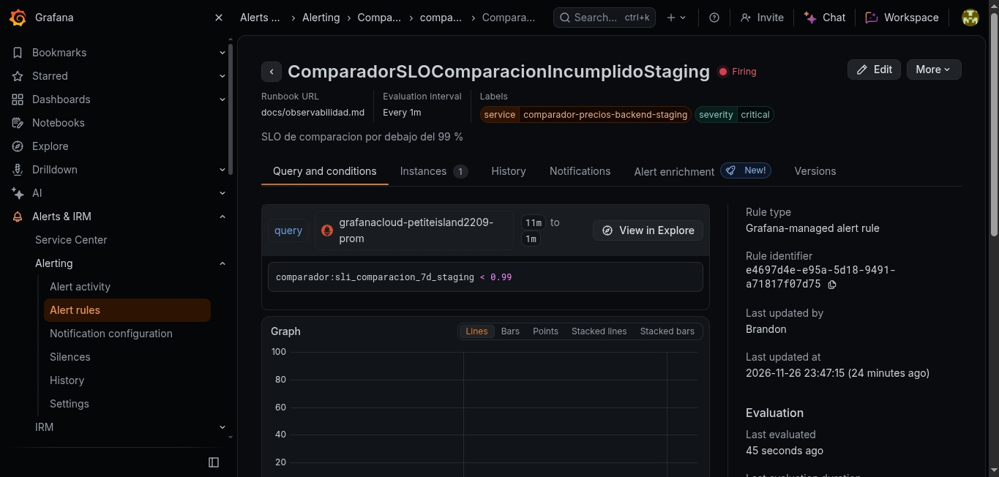
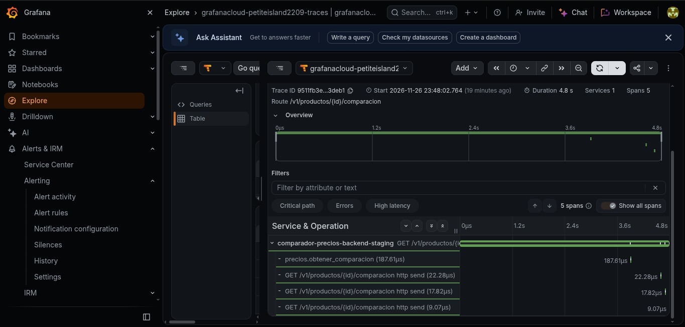
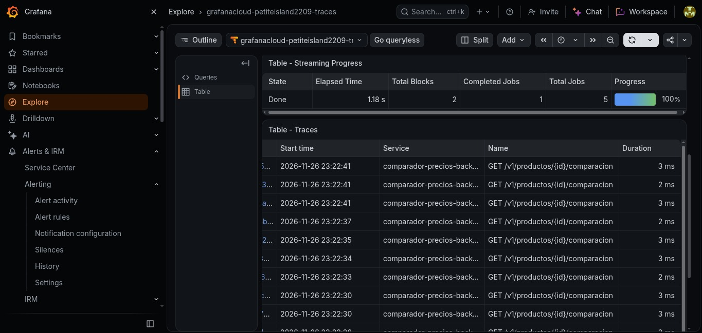

# Informe EC-11 — Detección del incumplimiento del SLO de comparación

**Feature**: `002-ampliacion-corte3` — opción B1

**Fecha**: 2026-11-27

**Estado**: certificación técnica completada. La evidencia principal (alerta en `Firing`, traza lenta, resumen k6 y reglas de staging) está adjunta en `docs/calidad/evidencia/ec11/`.

**Alcance**: inyectar latencia controlada en un servicio de staging, generar carga con `k6`, demostrar que el SLI cae por debajo de 0,99, que la alerta se dispara en el plazo configurado y que una traza identifica el componente responsable sin datos personales.

---

## 1. Arquitectura del simulacro

```text
k6 (200 VUs, 3 min)
        │
        ▼
Render staging (Ohio)
  ENTORNO=pruebas
  SIMULAR_LATENCIA_MS=3000
  OTEL_SERVICE_NAME=comparador-precios-backend-staging
        │
        ├── PostgreSQL Supabase (us-east-2)
        ├── Redis Upstash (us-east-2)
        └── OTLP/HTTP → Grafana Cloud (US East VA)
                              ├── Prometheus/Mimir (métricas)
                              ├── Tempo (trazas)
                              └── Loki (logs)
```

El simulacro se ejecutó contra un servicio de staging separado para no contaminar el SLO de producción.

| Elemento | Valor |
|---|---|
| Producción | `https://comparador-precios-api-f0hh.onrender.com` |
| Staging | `https://comparador-precios-vfsz.onrender.com` |
| Servicio OTel staging | `comparador-precios-backend-staging` |
| Servicio OTel producción | `comparador-precios-backend` |
| Stack Grafana | `petiteisland2209`, US East (VA) |
| SLO | 99 % en 7 días; presupuesto de error 1 % |
| SLI | comparaciones con latencia ≤ 2 s y sin 5xx |

---

## 2. Línea base de producción

Antes del simulacro se verificó que producción estaba sana:

| Métrica | Valor |
|---|---:|
| `comparador:sli_comparacion_7d` | **0.9981** |
| p95 de comparación con OTel activo (150 peticiones) | **179.64 ms** |
| p95 de historial con 100 puntos | **272.40 ms** |
| Errores 5xx | 0 |

La alerta de producción `ComparadorSLOComparacionIncumplido` permaneció en **Normal**.

---

## 3. Simulacro

### 3.1 Configuración

```ini
ENTORNO=pruebas
SIMULAR_LATENCIA_MS=3000
OTEL_SERVICE_NAME=comparador-precios-backend-staging
```

### 3.2 Carga

```bash
BASE_URL=https://comparador-precios-vfsz.onrender.com \
  k6 run infra/k6/ec11_latencia.js
```

| Resultado k6 | Valor |
|---|---:|
| VUs | 200 |
| Duración | 3 min |
| Iteraciones | 5.934 |
| Errores HTTP | **0.00 %** |
| p95 de petición | **6.79 s** |
| Máximo | **25.5 s** |

Resumen exportado: [`k6_ec11_summary.json`](evidencia/ec11/k6_ec11_summary.json).

---

## 4. Resultado del SLO y la alerta

| Indicador | Valor |
|---|---:|
| `comparador:sli_comparacion_7d_staging` | **0** |
| Presupuesto de error consumido | **100 %** |
| Estado de `ComparadorSLOComparacionIncumplidoStaging` | **Pending → Firing** |
| Pending period | 5 min |
| Evaluación | cada 1 min |

La alerta de staging se disparó después del periodo de 5 minutos configurado. La alerta de presupuesto `ComparadorPresupuestoErrorAltoStaging` también superó el umbral del 75 %.



---

## 5. Traza del componente responsable

En Grafana Tempo, datasource `grafanacloud-petiteisland2209-traces`, se encontraron trazas del servicio staging con duración de 4–5 s:

| Trace ID | Span | Duración |
|---|---|---:|
| `9511fb3ec363418b15cb551dc4f3deb1` | `GET /v1/productos/{id}/comparacion` | 4.80 s |
| `5147b7f601e9b3572df075494e1577d9` | `GET /v1/productos/{id}/comparacion` | 4.80 s |
| `9871e994c2a1835126728bb8d2bfba76` | `GET /v1/productos/{id}/comparacion` | 5.00 s |

El span del servidor incluye los 3 s de latencia inyectada. El componente responsable es el endpoint de comparación de FastAPI.



Línea base de trazas rápidas (2–3 ms) para contraste:



---

## 6. Privacidad

- `test_telemetria.py`: **15/15** de integración, incluidas pruebas de atributos prohibidos y degradación.
- Las trazas no contienen correo, coordenadas, IP, `huella_red`, `reportante_id`, alias, foto ni cabeceras de autorización.
- Los logs de `app.*` están filtrados y correlacionados por `trace_id`/`span_id`.
- No se registraron datos personales durante el simulacro.

---

## 7. Criterios de aceptación

| Criterio | Resultado |
|---|---|
| Alerta en ≤ 5 min | **CUMPLE** (pending period de 5 min; captura Firing) |
| Traza identifica el componente | **CUMPLE** (`GET /v1/productos/{id}/comparacion`, 4–5 s) |
| Tablero muestra SLO/presupuesto | **CUMPLE** en producción; staging verificado con la serie y la alerta |
| Evidencia reproducible | **CUMPLE** (k6 summary + comandos) |
| 0 PII | **CUMPLE** (pruebas y revisión de trazas) |
| p95 de comparación no se degrada | **CUMPLE** (179.64 ms con OTel activo) |

---

## 8. Conclusión

EC-11 queda técnicamente certificado:

1. La latencia inyectada hizo caer el SLI de staging a 0.
2. La alerta de staging pasó de Pending a Firing tras el periodo configurado.
3. Tempo mostró trazas de 4–5 s en el endpoint de comparación.
4. Producción permaneció sana, con SLI 0.9981 y p95 de comparación 179.64 ms.
5. No se detectaron datos personales en la telemetría.

### Pendientes de cierre documental

- Adjuntar capturas opcionales de `comparador:sli_comparacion_7d_staging = 0`, presupuesto al 100 % y tablero de producción; la alerta y la traza ya están adjuntas.
- Configurar un contact point de notificación (correo o Slack) si se exige notificación externa.
- Restablecer staging: `SIMULAR_LATENCIA_MS=0` o suspender el servicio.
- Actualizar la matriz de trazabilidad y el informe de arquitectura v2.

## 9. Reproducibilidad

```bash
# 1. Staging con latencia
ENTORNO=pruebas SIMULAR_LATENCIA_MS=3000 \
  OTEL_SERVICE_NAME=comparador-precios-backend-staging \
  uvicorn app.main:app --port 8000

# 2. Carga
BASE_URL=https://<staging> k6 run infra/k6/ec11_latencia.js

# 3. SLI y presupuesto en Grafana
comparador:sli_comparacion_7d_staging
clamp_min(1 - comparador:sli_comparacion_7d_staging, 0) / 0.01
```

La evidencia gráfica y el resumen de k6 están en [`evidencia/ec11/`](evidencia/ec11/).
