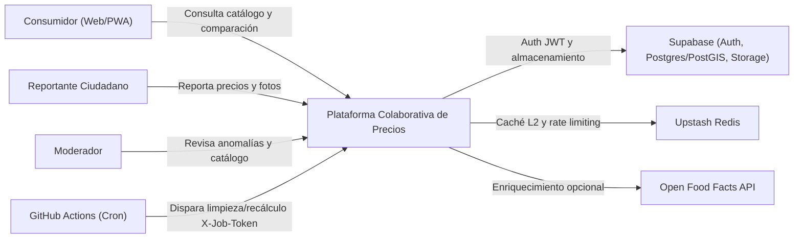
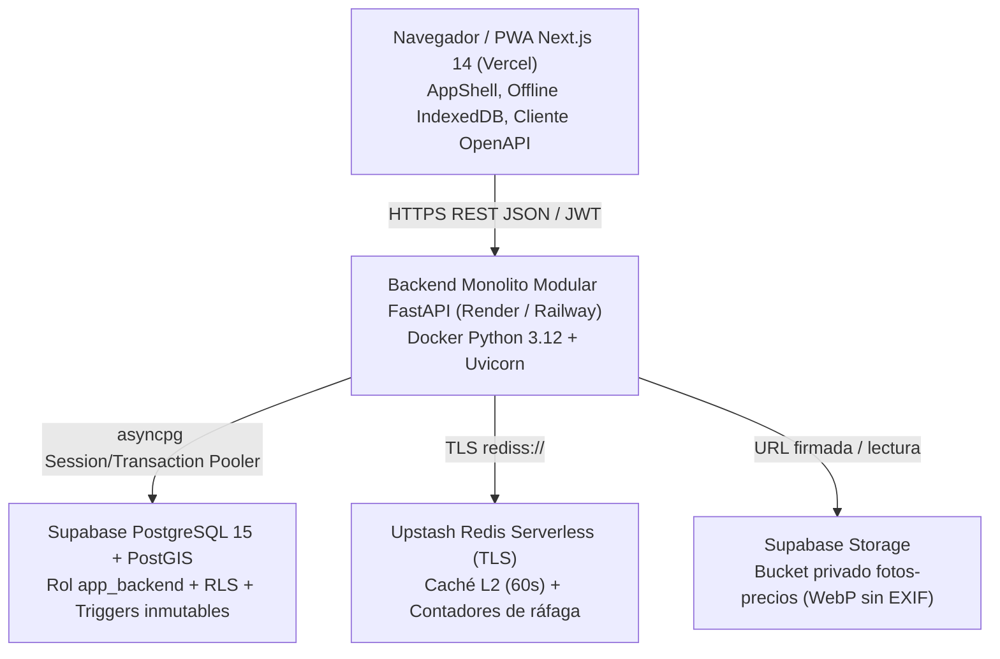

# Documento de Arquitectura v1 — Núcleo del Comparador de Precios (`Entregable 5`)

**Versión:** `v1.0-nucleo` | **Fecha:** 2026-11-14 | **Alcance:** Etapa 1 completa (`T-00` a `T-55`)

---

## 1. Contexto del Sistema y Alcance del Núcleo

La plataforma resuelve la asimetría de información y dispersión de precios de la canasta familiar en ciudades intermedias colombianas (caso base: **Armenia, Quindío**). Permite a consumidores comparar precios reales normalizados por unidad homogénea (`COP/kg`, `COP/l`, `COP/unidad`) entre tiendas de barrio, minimercados, supermercados y cadenas, con datos aportados y validados colaborativamente por la comunidad bajo estricta neutralidad comercial y protección de datos personales (**Ley 1581 de 2012**).

En la versión `v1.0-nucleo` (Etapa 1) se entrega el sistema operativo completo: catálogo normalizado, georreferenciación PostGIS, registro inmutable de reportes con resiliencia offline, motor estadístico antifraude, caché de dos niveles, moderación y panel web PWA accesible (**WCAG 2.2 AA**). El módulo comercial de promociones (`comercial`) queda desacoplado estructuralmente mediante el bloque separado en respuestas y se implementará en la Etapa 2 sin posibilidad de alterar el ranking.

---

## 2. Conductores Arquitectónicos (`EC-01` a `EC-06`)

| Código | Atributo / Norma | Meta cuantitativa y mecanismo arquitectónico |
|---|---|---|
| **`EC-01`** | Usabilidad en campo (ISO 25010) | Registro de reporte completo en **<= 15 s** (P75 observado en pruebas automatizadas) y accesibilidad **WCAG 2.2 AA** (`0` violaciones críticas/serias con `axe-core`), con cola offline en `IndexedDB`. |
| **`EC-02`** | Actualidad de información (ISO 25012) | Todo cambio por reporte aceptado o resolución de moderación se refleja en la comparación en **<= 60 s** mediante invalidación síncrona por producto (`CacheDosNiveles.invalidar_producto`). Certificado **100/100** (`max = 6.94 s`). |
| **`EC-03`** | Credibilidad e integridad de datos | Rechazo/cuarentena de precios atípicos (*z-score*, MAD y referencia jerárquica de 3 niveles), detección de ráfagas (`HLL/HMAC`) y trazabilidad inmutable en `reporte_precio` + `auditoria`. |
| **`EC-04`** | Escalabilidad y eficiencia bajo carga | Soportar **500 VUs concurrentes** (`60 %` catálogo, `30 %` comparación, `5 %` tiendas, `5 %` reportes) con caché L1/L2 y tasa de error `< 1 %` (`0.00 %` en prueba ASGI sobre `--workers 1`). |
| **`EC-05`** | Seguridad, privacidad y Ley 1581 | Consentimiento previo obligatorio (`403 AUTORIZACION_REQUERIDA`), nunca persistir ni loguear `lat`/`lng` del usuario, anonimización ARCO en `DELETE /v1/mi-cuenta` y `huella_red` HMAC diaria purgada a los 30 días. |
| **`EC-06`** | Neutralidad comercial estructural | El módulo `precios` **nunca** importa al módulo `comercial` (verificado por `import-linter`), las promociones viajan en un bloque independiente y jamás modifican el ordenamiento por precio unitario. |

---

## 3. Comparativa de Alternativas Arquitectónicas y Decisiones (`ADR-001` a `ADR-018`)

Las decisiones clave se encuentran documentadas en `docs/adr/`. A continuación se sintetizan las comparativas estructurales principales:

### 3.1 Estilo de API y Framework Backend (`ADR-003`)

| Criterio | **FastAPI (Python 3.12) + REST OpenAPI 3.1 (Elegido)** | NestJS (TypeScript) + GraphQL |
|---|---|---|
| **Cómputo numérico y TDD** | Ecosistema nativo con `Decimal`, `statistics`, `pytest` y pruebas de propiedades con `hypothesis`. | Librerías estadísticas dispersas; sobrecarga para cálculos deterministas de mediana ponderada y *z-score*. |
| **Caché L2 en Redis (`EC-02`)** | Claves deterministas por URL/parámetros (`cmp:{producto_id}`) fáciles de cachear e invalidar. | El AST dinámico de GraphQL dificulta cachear respuestas completas y abre riesgo de consultas N+1 bajo 500 VUs. |
| **Control anti-ráfagas (`EC-03`)** | Rate limiting inmediato por ruta y verbo HTTP (`POST /v1/reportes`). | Requiere análisis de profundidad/complejidad de consultas. |
| **Contrato tipado con frontend (`ADR-004`)** | Generación automática de `openapi.json` -> `openapi-typescript` sin lógica de negocio en el navegador. | Acoplamiento mayor con cliente GraphQL y cache normalizada en el cliente. |

### 3.2 Otras Alternativas Clave Resueltas
- **PWA frente a app nativa (`ADR-001`)**: Next.js 14 PWA permite instalación instantánea y cola offline en `IndexedDB` sin fricción ni costos de tiendas móviles.
- **Monolito modular frente a microservicios (`ADR-002`)**: Despliegue de costo cero y baja latencia intra-proceso protegiendo los límites entre módulos mediante `import-linter` (`3` contratos estrictos).
- **Supabase PostgreSQL + PostGIS frente a NoSQL (`ADR-005`)**: Consultas espaciales exactas (`ST_DWithin`), integridad referencial estricta para evidencia inmutable y triggers anti-borrado.
- **Historial inmutable separado de proyección (`ADR-009`)**: `reporte_precio` es *append-only* (evidencia) mientras `precio_vigente` es la proyección materializada recalculada para lecturas rápidas.

---

## 4. Vistas C4 de la Arquitectura

Las fuentes editables en Mermaid se mantienen en [c1_contexto.mmd](file:///c:/Users/CODEBOOK/Desktop/comparador-precios/docs/c4/c1_contexto.mmd), [c2_contenedores.mmd](file:///c:/Users/CODEBOOK/Desktop/comparador-precios/docs/c4/c2_contenedores.mmd) y [c3_componentes.mmd](file:///c:/Users/CODEBOOK/Desktop/comparador-precios/docs/c4/c3_componentes.mmd).

### 4.1 Nivel 1 — Contexto del Sistema

### 4.2 Nivel 2 — Contenedores

### 4.3 Nivel 3 — Componentes del Backend (`backend/app/`)
- **`dominio/` (Puro, sin I/O, probado con TDD + `hypothesis`)**: `unidades.py`, `anomalia.py`, `riesgo.py`, `reputacion.py`, `vigencia.py`, `sello.py`, `orden.py`, `parametros.py`.
- **`puertos/` y `adaptadores/` (Hexagonal ligero)**:
  - `PuertoPoliticaPrecio` (`SoloUsuarios`) -> desacopla el cálculo de precio vigente de futuras políticas comerciales (`EC-06`).
  - `PuertoCache` (`CacheDosNiveles`) -> L1 local en proceso (`5 s`) + L2 Redis (`60 s`).
  - `PuertoAlmacenamiento` (`AdaptadorStorageSupabase`) y `PuertoCatalogoExterno` (`AdaptadorOpenFoodFacts` con *circuit breaker*).
- **`modulos/`**: `catalogo`, `establecimientos`, `precios`, `confianza`, `fotos`, `cuentas`, `moderacion`, `comercial` (aislado).
- **`compartido/` y `tareas/`**: seguridad JWT, catálogo de errores RFC 9457, registro estructurado sin coordenadas y jobs internos `/internal/jobs/{nombre}`.

---

## 5. Modelo de Datos Inmutable y Seguridad (`app_backend` + Ley 1581)

1. **Separación Evidencia vs. Proyección (`ADR-009`)**:
   - `reporte_precio` y `auditoria` son inmutables mediante triggers PL/pgSQL (`trg_inmutabilidad_reporte`) y revocación de `DELETE`/`UPDATE` al rol de aplicación `app_backend`.
   - `precio_vigente` almacena el resumen vigente calculado (`precio_cop`, `precio_por_base`, `sello`, `n_reportes_validos`, `n_fuentes`) recalculado de forma atómica tras cada reporte aceptado o decisión de moderación.
2. **Seguridad y Mínimo Privilegio (`ADR-012`)**:
   - RLS habilitado en todas las tablas sin políticas públicas permisivas; la conexión del backend autentica como rol `app_backend` con permisos granulares.
   - Autenticación delegada a **Supabase Auth (JWT)** validada en backend con matriz RBAC verificada en [test_matriz_permisos.py](file:///c:/Users/CODEBOOK/Desktop/comparador-precios/backend/tests/contrato/test_matriz_permisos.py).
3. **Privacidad y Derechos ARCO (`Ley 1581`)**:
   - Ninguna tabla ni log almacena `lat`/`lng` del consumidor; `huella_red` usa HMAC-SHA256 con rotación diaria y purga automática a los 30 días.
   - `DELETE /v1/mi-cuenta` anonimiza los aportes históricos (`reportante_id = NULL`, alias anónimo) garantizando el derecho de supresión sin destruir la evidencia estadística ni la integridad del historial.

---

## 6. Contratos de API y Trazabilidad Documental

- **Contrato OpenAPI 3.1**: Exportado de forma determinista en [docs/api/openapi.json](file:///c:/Users/CODEBOOK/Desktop/comparador-precios/docs/api/openapi.json) (`application/problem+json` bajo RFC 9457 para errores `400/401/403/404/409/422/429/503`).
- **Grupos de endpoints v1**:
  - Públicos: `/v1/salud`, `/v1/categorias`, `/v1/productos`, `/v1/productos/{id}`, `/v1/productos/{id}/comparacion`, `/v1/establecimientos`, `/v1/establecimientos/{id}/solicitudes-correccion`, `/v1/legal/politica-tratamiento`.
  - Reportante / Cuenta autenticada: `/v1/mi-cuenta` (`GET`/`PATCH`/`DELETE`), `/v1/mi-cuenta/autorizacion`, `/v1/reportes`, `/v1/mis-reportes`, `/v1/fotos/url-subida`, `/v1/sugerencias-presentacion`.
  - Moderación: `/v1/moderacion/*` (catálogo, casos, sanciones, auditoría y los `43` parámetros en `config_parametro`).
  - Jobs internos (`X-Job-Token`): `/internal/jobs/{limpiar-idempotencia|recalcular-vencimientos|purgar-huellas|cerrar-disputas-vencidas|ping_bd}`.
- **Trazabilidad completa**: [trazabilidad.csv](file:///c:/Users/CODEBOOK/Desktop/comparador-precios/docs/calidad/trazabilidad.csv) enlaza cada requisito `RF/EC` con sus módulos, ADRs y pruebas automáticas.

