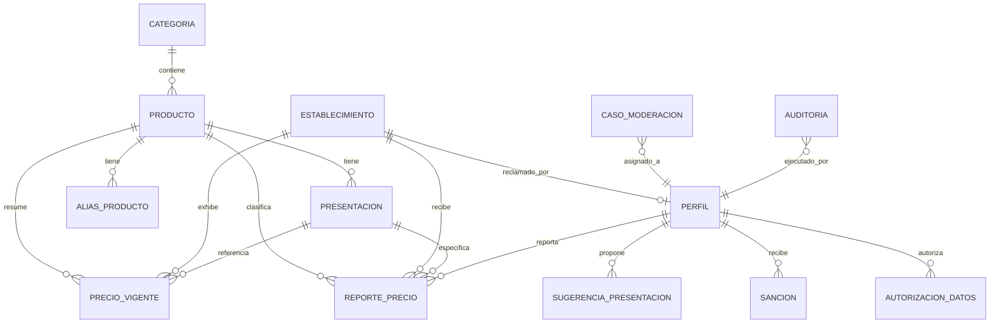

# Data Model: Núcleo del Comparador de Precios (001-nucleo-comparador)

**Branch**: `001-nucleo-comparador` | **Feature**: Núcleo del Comparador | **Date**: 2026-11-02

Este documento formaliza el modelo de datos relacional en PostgreSQL 16 (Supabase), los esquemas de tipos, las restricciones de integridad y las fórmulas matemáticas del dominio puro implementadas para la Etapa 1.

---

## 1. Diagrama Entidad-Relación (Modelo Conceptual del Núcleo)



---

## 2. Tipos Enumerados (ENUMs)

```sql
create type rol_usuario as enum ('reportante', 'comercio', 'moderador');
create type estado_cuenta as enum ('activa', 'suspendida', 'bloqueada', 'eliminada');
create type unidad_base as enum ('g', 'ml', 'unidad');
create type unidad_entrada as enum ('g', 'kg', 'lb', 'ml', 'l', 'unidad', 'docena');
create type tipo_establecimiento as enum ('tienda_barrio', 'minimercado', 'supermercado', 'cadena');
create type estado_verificacion as enum ('sin_dueno', 'pendiente', 'verificado');
create type fuente_precio as enum ('usuario', 'comercio', 'semilla');
create type estado_confianza as enum ('aceptado', 'dudoso', 'rechazado');
create type sello_precio as enum ('confiable', 'pocos_datos', 'dudoso', 'desactualizado', 'oficial', 'en_disputa');
create type tipo_caso as enum ('reporte_dudoso', 'rafaga', 'solicitud_correccion', 'sugerencia_presentacion', 'verificacion_comercio', 'disputa_precio');
create type estado_caso as enum ('abierto', 'en_revision', 'resuelto');
create type decision_caso as enum ('confirmar', 'descartar', 'sancionar');
create type tipo_sancion as enum ('advertencia', 'suspension', 'bloqueo');
```

---

## 3. Entidades y Estructura de Tablas (Migraciones 0001 a 0003)

### 3.1 `categoria`
Agrupa los productos en las 10 familias de la canasta familiar básica.
- `id`: `smallint` (PK, 1 al 10).
- `nombre`: `text` (Unique, 2 a 80 caracteres).
- `padre_id`: `smallint` (FK auto-referencial opcional para jerarquías futuras).
- `orden`: `smallint` (Default 0).

### 3.2 `producto`
Bien genérico de consumo. Define la unidad de medida base sobre la cual se calcula la comparación económica.
- `id`: `uuid` (PK, Default `gen_random_uuid()`).
- `nombre`: `text` (Unique, 2 a 120 caracteres).
- `nombre_norm`: `text` (Nombre normalizado sin acentos en minúsculas para índice trigrama).
- `categoria_id`: `smallint` (FK a `categoria.id`).
- `unidad_base`: `unidad_base` (`g`, `ml` o `unidad`).
- `imagen_url`: `text` (Opcional, $\le 500$ caracteres).
- `activo`: `boolean` (Default `true`).
- `creado_en` / `actualizado_en`: `timestamptz`.

### 3.3 `presentacion`
Variante comercial empacada de un producto. Precalcula su `cantidad_base` inmutable.
- `id`: `uuid` (PK, Default `gen_random_uuid()`).
- `producto_id`: `uuid` (FK a `producto.id`).
- `marca`: `text` (Opcional, 1 a 80 caracteres).
- `valor_cantidad`: `numeric(12,3)` (Mayor a cero).
- `unidad`: `unidad_entrada` (`g`, `kg`, `lb`, `ml`, `l`, `unidad`, `docena`).
- `multiplicador`: `smallint` (Default 1, $\ge 1$).
- `cantidad_base`: `numeric(14,3)` (Precalculada en `unidad_base`, inmutable).
- `etiqueta`: `text` (Denominación comercial, ej. "Arroz Diana 500 g").
- `etiqueta_norm`: `text` (Normalizada para búsqueda con trigramas).
- `codigo_barras`: `text` (Unique, 8 a 14 dígitos numéricos).
- `fuente_catalogo`: `text` (`manual`, `semilla`, `open_food_facts`).
- `activa`: `boolean` (Default `true`).
- Restricción única: `UNIQUE NULLS NOT DISTINCT (producto_id, marca, cantidad_base)`.

### 3.4 `establecimiento`
Comercio físico donde se adquieren los productos.
- `id`: `uuid` (PK, Default `gen_random_uuid()`).
- `nombre`: `text` (2 a 120 caracteres).
- `tipo`: `tipo_establecimiento` (`tienda_barrio`, `minimercado`, `supermercado`, `cadena`).
- `cadena`: `text` (Opcional, $\le 80$ caracteres).
- `direccion`: `text` (3 a 200 caracteres).
- `barrio`: `text` (Opcional, $\le 80$ caracteres).
- `municipio`: `text` (Default 'Armenia').
- `departamento`: `text` (Default 'Quindío').
- `ubicacion`: `geography(Point, 4326)` (Coordenadas PostGIS fijas de la tienda).
- `osm_id`: `bigint` (Identificador de procedencia en OpenStreetMap).
- `comercio_id`: `uuid` (Punto de extensión para Etapa 2, FK a `perfil.id` `on delete set null`).
- `estado_verificacion`: `estado_verificacion` (Default `'sin_dueno'`).
- `activo`: `boolean` (Default `true`).
- Restricción única: `UNIQUE (nombre, direccion)`.

### 3.5 `perfil`
Cuenta de usuario autenticado mediante Supabase Auth.
- `id`: `uuid` (PK, id correspondiente en `auth.users`).
- `alias`: `text` (Unique, 3 a 30 caracteres alfanuméricos con punto, guión o guión bajo).
- `rol`: `rol_usuario` (Default `'reportante'`).
- `estado`: `estado_cuenta` (Default `'activa'`).
- `suspendida_hasta`: `timestamptz` (Opcional, para sanciones temporales).
- `reputacion`: `numeric(4,3)` (Default `0.500`, escala $[0, 1]$).
- `reportes_corroborados`: `int` (Default 0, $A$).
- `reportes_malos_confirmados`: `int` (Default 0, $M$).
- `creado_en` / `actualizado_en`: `timestamptz`.

### 3.6 `autorizacion_datos`
Registro legal probatorio de autorización de tratamiento de datos personales (Ley 1581 de 2012).
- `id`: `uuid` (PK).
- `usuario_id`: `uuid` (FK a `perfil.id` `on delete cascade`).
- `version_politica`: `text` (Versión aceptada, ej. `'1.0'`).
- `finalidad`: `text` (Texto legal de la autorización consentida).
- `aceptada_en`: `timestamptz` (Default `now()`).
- `revocada_en`: `timestamptz` (Marca temporal de revocación al solicitar eliminación de cuenta).

### 3.7 `reporte_precio` (Inmutable, Append-Only)
Evidencia histórica atómica de un precio observado.
- `id`: `uuid` (PK).
- `presentacion_id`: `uuid` (FK a `presentacion.id`).
- `establecimiento_id`: `uuid` (FK a `establecimiento.id`).
- `producto_id`: `uuid` (FK a `producto.id`).
- `precio_cop`: `integer` ($\ge 1$, entero en pesos COP).
- `incluye_impuestos`: `boolean` (Default `true`, check estricto `true`).
- `cantidad_base_snapshot`: `numeric(14,3)` (Copia inmutable de la cantidad base).
- `precio_por_base`: `numeric(14,6)` (Precio por gramo, mililitro o unidad).
- `fuente`: `fuente_precio` (`usuario`, `comercio`, `semilla`).
- `reportante_id`: `uuid` (FK a `perfil.id` `on delete set null`; anulable para anonimización).
- `observado_en`: `timestamptz` (Momento de la observación en góndola).
- `foto_prueba_path`: `text` (Ruta en bucket privado, nulo al borrar cuenta o si no aportó foto).
- `estado`: `estado_confianza` (`aceptado`, `dudoso`, `rechazado`).
- `estado_original`: `estado_confianza` (Estado original otorgado por el motor determinista).
- `senales`: `text[]` (Arreglo de banderas internas, ej. `['cuenta_nueva', 'sin_foto']`).
- `puntaje_anomalia`: `numeric(8,3)` (Valor de $M$ o $d$).
- `riesgo_contexto`: `numeric(4,3)` ($[0, 1]$).
- `conjunto_referencia`: `text` (`presentacion_tienda`, `presentacion`, `producto_unitario`, `sin_referencia`).
- `huella_red`: `text` (Hash SHA-256 de 64 caracteres, anulable tras 30 días).
- `idempotency_key`: `uuid` (Llave de idempotencia del cliente).
- `es_demo`: `boolean` (Default `false`).
- `revisado_por`: `uuid` (FK a `perfil.id` del moderador si fue revisado).
- `revisado_en`: `timestamptz`.
- `creado_en`: `timestamptz` (Default `now()`).
- Restricción única: `UNIQUE (reportante_id, idempotency_key)`.

#### Trigger de Inmutabilidad (`trg_inmutabilidad_reporte`)
```sql
create or replace function bloquear_cambios_reporte()
returns trigger language plpgsql as $$
begin
  if tg_op = 'DELETE' then
    raise exception 'PROHIBIDO_BORRAR_REPORTE: La tabla reporte_precio es inmutable.';
  end if;

  if new.id <> old.id
     or new.presentacion_id <> old.presentacion_id
     or new.establecimiento_id <> old.establecimiento_id
     or new.producto_id <> old.producto_id
     or new.precio_cop <> old.precio_cop
     or new.cantidad_base_snapshot <> old.cantidad_base_snapshot
     or new.precio_por_base <> old.precio_por_base
     or new.fuente <> old.fuente
     or new.observado_en <> old.observado_en
     or new.estado_original <> old.estado_original
     or new.es_demo <> old.es_demo
     or new.creado_en <> old.creado_en then
    raise exception 'PROHIBIDO_MODIFICAR_REPORTE: Los campos de evidencia del reporte son inmutables.';
  end if;

  if old.reportante_id is not null and new.reportante_id is not null and new.reportante_id <> old.reportante_id then
    raise exception 'PROHIBIDO_CAMBIAR_AUTOR: Solo se permite anonimizar reportante_id a NULL.';
  end if;

  return new;
end;
$$;
```

### 3.8 `precio_vigente` (Modelo de Lectura Precalculado)
Tabla precalculada para responder comparaciones instantáneas sin escanear el historial completo.
- `presentacion_id`: `uuid` (PK compuesta).
- `establecimiento_id`: `uuid` (PK compuesta).
- `producto_id`: `uuid` (FK a `producto.id`).
- `precio_cop`: `integer` (Mediana ponderada de los reportes vigentes).
- `precio_por_base`: `numeric(14,6)`.
- `cantidad_base`: `numeric(14,3)`.
- `sello`: `sello_precio` (`confiable`, `pocos_datos`, `dudoso`, `desactualizado`, `oficial`, `en_disputa`).
- `motivo_sello`: `text` ($\le 200$ caracteres).
- `n_reportes_validos`: `smallint`.
- `n_fuentes`: `smallint` (Cuentas independientes).
- `dispersion`: `numeric(6,4)` ($\text{MAD} / \text{mediana}$).
- `ultimo_reporte_en`: `timestamptz`.
- `reporte_origen_id`: `uuid` (FK opcional a `reporte_precio.id`).
- `recalculado_en`: `timestamptz` (Default `now()`).

### 3.9 `caso_moderacion`
Expediente operativo para auditoría y resolución por parte del moderador humano.
- `id`: `uuid` (PK).
- `tipo`: `tipo_caso` (`reporte_dudoso`, `rafaga`, `solicitud_correccion`, `sugerencia_presentacion`, `verificacion_comercio`, `disputa_precio`).
- `referencia_tabla`: `text` (Tabla afectada, ej. `'reporte_precio'`).
- `referencia_id`: `uuid`.
- `detalle`: `jsonb` (Metadatos del caso, señales y contexto).
- `prioridad`: `smallint` (1 a 5, siendo 1 máxima prioridad para ráfagas).
- `estado`: `estado_caso` (`abierto`, `en_revision`, `resuelto`).
- `decision`: `decision_caso` (`confirmar`, `descartar`, `sancionar`).
- `moderador_id`: `uuid` (FK a `perfil.id`).
- `nota`: `text` (Explicación del moderador).
- `creado_en` / `resuelto_en`: `timestamptz`.

### 3.10 `auditoria` (Append-Only)
Bitácora de seguridad que registra cada cambio sensible del sistema.
- `id`: `bigserial` (PK).
- `actor_id`: `uuid` (Usuario que ejecutó la acción).
- `rol`: `text`.
- `accion`: `text` (Nombre de la operación).
- `entidad`: `text` (Tabla impactada).
- `entidad_id`: `text`.
- `antes`: `jsonb` (Estado previo).
- `despues`: `jsonb` (Estado resultante).
- `creado_en`: `timestamptz`.
- Permisos: Se revoca expresamente `UPDATE` y `DELETE` para `app_backend`.

### 3.11 `config_parametro`
Almacén centralizado de los 43 parámetros y umbrales de negocio.
- `clave`: `text` (PK, 3 a 80 caracteres).
- `valor`: `jsonb` (Valor numérico, textual o arreglo estructurado).
- `descripcion`: `text` ($\le 300$ caracteres).
- `actualizado_por`: `uuid`.
- `actualizado_en`: `timestamptz`.

---

## 4. Fórmulas Matemáticas y Lógica del Dominio Puro

### 4.1 Aritmética de Unidades y Normalización (`unidades.py`)
- **Conversión de volumen y masa:**
  $$C_{\text{base}} = \left(V_{\text{cantidad}} \times F_{\text{conversion}} \times M_{\text{multiplicador}}\right).\text{quantize}(\text{Decimal}('0.001'))$$
  Factores exactos: $1\text{ kg} = 1.000\text{ g}$, $1\text{ lb (colombiana)} = 500\text{ g}$, $1\text{ L} = 1.000\text{ ml}$, $1\text{ docena} = 12\text{ unidades}$.
- **Precio por Unidad Base:**
  $$P_{\text{base}} = \left(\frac{\text{Decimal}(\text{precio\_cop})}{C_{\text{base}}}\right).\text{quantize}(\text{Decimal}('0.000001'), \text{rounding}=\text{ROUND\_HALF\_UP})$$

### 4.2 Reputación Bayesiana (`reputacion.py`)
$$\text{reputacion} = \text{Decimal}\left(\frac{A + 2}{A + 3M + 4}\right).\text{quantize}(\text{Decimal}('0.001'), \text{rounding}=\text{ROUND\_HALF\_UP})$$

### 4.3 Detección Determinista de Anomalías (`anomalia.py`, `riesgo.py`)
Sea $x$ el valor reportado, $m = \text{mediana}(\text{valores\_ref})$ y $\text{MAD} = \text{mediana}(\{|v - m| \text{ para } v \in \text{valores\_ref}\})$.
- Si $n \ge 5$ y $\text{MAD} > 0$:
  $$M = \frac{0.6745 \times (x - m)}{\text{MAD}}$$
  Anómalo si $|M| > 3.5$ o $x > 5m$ o $x < m/5$.
- Si $n \in \{3, 4\}$ o $\text{MAD} = 0$:
  $$d = \frac{|x - m|}{m}$$
  Anómalo si $d > 0.30$ o $x > 5m$ o $x < m/5$.
- Riesgo de Contexto:
  $$R_{\text{contexto}} = 0.15 \cdot \mathbb{I}(\text{sin\_foto}) + 0.25 \cdot \mathbb{I}(\text{cuenta\_nueva}) + 0.40 \cdot \mathbb{I}(\text{rafaga}) + 0.20 \cdot \mathbb{I}(\text{reputacion\_baja})$$
  Clasifica como `dudoso` si es anómalo o si $R_{\text{contexto}} \ge 0.60$.

### 4.4 Decaimiento Exponencial y Mediana Ponderada (`vigencia.py`)
Para cada reporte con antigüedad $t$ en horas:
$$\text{exponente} = \frac{\max(0.0, t - 48)}{72}$$
$$w_i = \text{reputacion\_autor} \times \left(0.5^{\text{exponente}}\right) \times (1.2 \text{ si tiene foto sino } 1.0)$$
El precio representativo es el valor de $x$ que acumula $\ge 50\%$ de la suma ponderada total $\sum w_i$.
