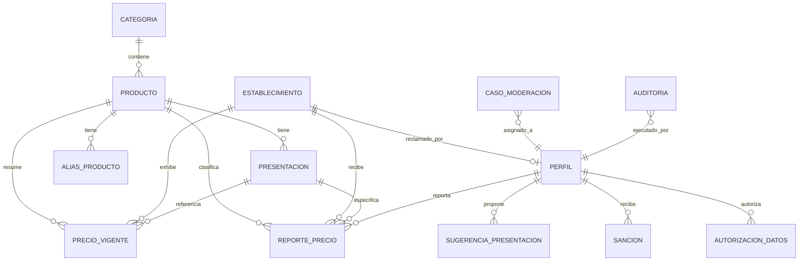

# Data Model: Núcleo del Comparador de Precios (001-nucleo-comparador)

**Branch**: `001-nucleo-comparador` | **Feature**: Núcleo del Comparador | **Date**: 2026-11-02

Este documento formaliza el modelo de datos relacional en PostgreSQL 16 (Supabase), los esquemas de tipos, las restricciones de integridad y las fórmulas matemáticas del dominio puro implementadas para la Etapa 1.

---

## 1. Diagrama Entidad-Relación (Modelo Conceptual del Núcleo)



---

## 2. Fundaciones de Seguridad, Extensiones y Tipos Enumerados (ENUMs)

### 2.1 Extensiones y Rol `app_backend` con `LOGIN` (Migración `0001_fundaciones_seguridad.sql`)

```sql
create extension if not exists postgis;
create extension if not exists pg_trgm;
create extension if not exists unaccent;
create extension if not exists pgcrypto;

-- Rol de aplicación con LOGIN y privilegios mínimos (cumple ADR-012)
do $$
begin
  if not exists (select 1 from pg_roles where rolname = 'app_backend') then
    create role app_backend with login password 'app_backend_local_pass';
  end if;
end
$$;

grant usage on schema public to app_backend;
revoke all on all tables in schema public from anon, authenticated;
alter default privileges in schema public revoke all on tables from anon, authenticated;
alter default privileges in schema public grant select, insert, update, delete on tables to app_backend;
alter default privileges in schema public grant usage, select on sequences to app_backend;
```

### 2.2 Tipos Enumerados (ENUMs — Migración `0002`)

```sql
create type rol_usuario as enum ('reportante', 'comercio', 'moderador');
create type estado_cuenta as enum ('activa', 'suspendida', 'bloqueada', 'eliminada');
create type unidad_base as enum ('g', 'ml', 'unidad');
create type unidad_entrada as enum ('g', 'kg', 'lb', 'ml', 'l', 'unidad', 'docena');
create type tipo_establecimiento as enum ('tienda_barrio', 'minimercado', 'supermercado', 'cadena');
create type estado_verificacion as enum ('sin_dueno', 'pendiente', 'verificado');
create type fuente_precio as enum ('usuario', 'comercio', 'semilla');
create type estado_confianza as enum ('aceptado', 'dudoso', 'rechazado');
create type sello_precio as enum ('confiable', 'pocos_datos', 'dudoso', 'desactualizado', 'oficial', 'en_disputa');
create type tipo_caso as enum ('reporte_dudoso', 'rafaga', 'solicitud_correccion', 'sugerencia_presentacion', 'verificacion_comercio', 'disputa_precio');
create type estado_caso as enum ('abierto', 'en_revision', 'resuelto');
create type decision_caso as enum ('confirmar', 'descartar', 'sancionar');
create type tipo_sancion as enum ('advertencia', 'suspension', 'bloqueo');
```

---

## 3. Entidades y Estructura de Tablas (Migraciones 0001 a 0003)

### 3.1 `categoria`
Agrupa los productos en las 10 familias de la canasta familiar básica.
- `id`: `smallint` (PK, 1 al 10).
- `nombre`: `text` (Unique, 2 a 80 caracteres).
- `padre_id`: `smallint` (FK auto-referencial opcional para jerarquías futuras).
- `orden`: `smallint` (Default 0).

### 3.2 `producto`
Bien genérico de consumo. Define la unidad de medida base sobre la cual se calcula la comparación económica.
- `id`: `uuid` (PK, Default `gen_random_uuid()`).
- `nombre`: `text` (Unique, 2 a 120 caracteres).
- `nombre_norm`: `text` (Nombre normalizado sin acentos en minúsculas para índice trigrama).
- `categoria_id`: `smallint` (FK a `categoria.id`).
- `unidad_base`: `unidad_base` (`g`, `ml` o `unidad`).
- `imagen_url`: `text` (Opcional, $\le 500$ caracteres).
- `activo`: `boolean` (Default `true`).
- `creado_en` / `actualizado_en`: `timestamptz`.

### 3.3 `presentacion`
Variante comercial empacada de un producto. Precalcula su `cantidad_base` inmutable.
- `id`: `uuid` (PK, Default `gen_random_uuid()`).
- `producto_id`: `uuid` (FK a `producto.id`).
- `marca`: `text` (Opcional, 1 a 80 caracteres).
- `valor_cantidad`: `numeric(12,3)` (Mayor a cero).
- `unidad`: `unidad_entrada` (`g`, `kg`, `lb`, `ml`, `l`, `unidad`, `docena`).
- `multiplicador`: `smallint` (Default 1, $\ge 1$).
- `cantidad_base`: `numeric(14,3)` (Precalculada en `unidad_base`, inmutable).
- `etiqueta`: `text` (Denominación comercial, ej. "Arroz Diana 500 g").
- `etiqueta_norm`: `text` (Normalizada para búsqueda con trigramas).
- `codigo_barras`: `text` (Unique, 8 a 14 dígitos numéricos).
- `fuente_catalogo`: `text` (`manual`, `semilla`, `open_food_facts`).
- `activa`: `boolean` (Default `true`).
- Restricción única: `UNIQUE NULLS NOT DISTINCT (producto_id, marca, cantidad_base)`.
- Índices: `idx_presentacion_etiqueta_trgm` (GIN `etiqueta_norm gin_trgm_ops`), `idx_presentacion_producto` (`producto_id` donde `activa = true`).

### 3.3.b `alias_producto`
Sinónimos y términos coloquiales de búsqueda asociados a un producto.
- `id`: `uuid` (PK, Default `gen_random_uuid()`).
- `producto_id`: `uuid` (FK a `producto.id` `on delete cascade`).
- `alias`: `text` (2 a 120 caracteres).
- `alias_norm`: `text` (Normalizado sin tildes en minúsculas).
- Restricción única: `UNIQUE (producto_id, alias_norm)`.
- Índice: `idx_alias_producto_trgm` (GIN `alias_norm gin_trgm_ops`).

### 3.4 `establecimiento`
Comercio físico donde se adquieren los productos.
- `id`: `uuid` (PK, Default `gen_random_uuid()`).
- `nombre`: `text` (2 a 120 caracteres).
- `tipo`: `tipo_establecimiento` (`tienda_barrio`, `minimercado`, `supermercado`, `cadena`).
- `cadena`: `text` (Opcional, $\le 80$ caracteres).
- `direccion`: `text` (3 a 200 caracteres).
- `barrio`: `text` (Opcional, $\le 80$ caracteres).
- `municipio`: `text` (Default 'Armenia').
- `departamento`: `text` (Default 'Quindío').
- `ubicacion`: `geography(Point, 4326)` (Coordenadas PostGIS fijas de la tienda).
- `osm_id`: `bigint` (Identificador de procedencia en OpenStreetMap).
- `comercio_id`: `uuid` (Punto de extensión para Etapa 2, FK a `perfil.id` `on delete set null`).
- `estado_verificacion`: `estado_verificacion` (Default `'sin_dueno'`).
- `activo`: `boolean` (Default `true`).
- Restricción única: `UNIQUE (nombre, direccion)`.

### 3.5 `perfil`
Cuenta de usuario autenticado mediante Supabase Auth.
- `id`: `uuid` (PK, id correspondiente en `auth.users`).
- `alias`: `text` (Unique, 3 a 30 caracteres alfanuméricos con punto, guión o guión bajo).
- `rol`: `rol_usuario` (Default `'reportante'`).
- `estado`: `estado_cuenta` (Default `'activa'`).
- `suspendida_hasta`: `timestamptz` (Opcional, para sanciones temporales).
- `reputacion`: `numeric(4,3)` (Default `0.500`, escala $[0, 1]$).
- `reportes_corroborados`: `int` (Default 0, $A$).
- `reportes_malos_confirmados`: `int` (Default 0, $M$).
- `creado_en` / `actualizado_en`: `timestamptz`.

### 3.6 `autorizacion_datos`
Registro legal probatorio de autorización de tratamiento de datos personales (Ley 1581 de 2012).
- `id`: `uuid` (PK, Default `gen_random_uuid()`).
- `usuario_id`: `uuid` (FK a `perfil.id` `on delete cascade`).
- `version_politica`: `text` (Versión aceptada, $\le 20$ caracteres, ej. `'1.0'`).
- `finalidad`: `text` (Texto legal de la autorización consentida, 20 a 2000 caracteres).
- `aceptada_en`: `timestamptz` (Default `now()`).
- `revocada_en`: `timestamptz` (Marca temporal de revocación al solicitar eliminación de cuenta).

### 3.6.b `sancion`
Registro disciplinario aplicado por un moderador humano a una cuenta infractora.
- `id`: `uuid` (PK, Default `gen_random_uuid()`).
- `usuario_id`: `uuid` (FK a `perfil.id`).
- `tipo`: `tipo_sancion` (`advertencia`, `suspension`, `bloqueo`).
- `motivo`: `text` (5 a 500 caracteres).
- `desde`: `timestamptz` (Default `now()`).
- `hasta`: `timestamptz` (Opcional).
- `moderador_id`: `uuid` (FK a `perfil.id`).
- `apelacion`: `text` (Opcional, $\le 1000$ caracteres).
- `apelacion_resuelta`: `boolean` (Opcional).

### 3.6.c `sugerencia_presentacion`
Propuesta de un usuario autenticado para dar de alta una variante comercial en el catálogo cerrado.
- `id`: `uuid` (PK, Default `gen_random_uuid()`).
- `usuario_id`: `uuid` (FK a `perfil.id` `on delete set null`).
- `producto_id`: `uuid` (FK opcional a `producto.id`).
- `texto_libre`: `text` (3 a 200 caracteres).
- `marca`: `text` (Opcional, $\le 80$ caracteres).
- `valor_cantidad`: `numeric(12,3)` (Opcional, $> 0$).
- `unidad`: `unidad_entrada` (Opcional).
- `codigo_barras`: `text` (Opcional, `^[0-9]{8,14}$`).
- `estado`: `text` (Default `'pendiente'`, en `'pendiente'`, `'aprobada'`, `'rechazada'`).
- `creado_en`: `timestamptz` (Default `now()`).

### 3.7 `reporte_precio` (Inmutable, Append-Only)
Evidencia histórica atómica de un precio observado.
- `id`: `uuid` (PK).
- `presentacion_id`: `uuid` (FK a `presentacion.id`).
- `establecimiento_id`: `uuid` (FK a `establecimiento.id`).
- `producto_id`: `uuid` (FK a `producto.id`).
- `precio_cop`: `integer` ($\ge 1$, entero en pesos COP).
- `incluye_impuestos`: `boolean` (Default `true`, check estricto `true`).
- `cantidad_base_snapshot`: `numeric(14,3)` (Copia inmutable de la cantidad base).
- `precio_por_base`: `numeric(14,6)` (Precio por gramo, mililitro o unidad).
- `fuente`: `fuente_precio` (`usuario`, `comercio`, `semilla`).
- `reportante_id`: `uuid` (FK a `perfil.id` `on delete set null`; anulable para anonimización).
- `observado_en`: `timestamptz` (Momento de la observación en góndola).
- `foto_prueba_path`: `text` (Ruta en bucket privado, nulo al borrar cuenta o si no aportó foto).
- `estado`: `estado_confianza` (`aceptado`, `dudoso`, `rechazado`).
- `estado_original`: `estado_confianza` (Estado original otorgado por el motor determinista).
- `senales`: `text[]` (Arreglo de banderas internas, ej. `['cuenta_nueva', 'sin_foto']`).
- `puntaje_anomalia`: `numeric(8,3)` (Valor de $M$ o $d$).
- `riesgo_contexto`: `numeric(4,3)` ($[0, 1]$).
- `conjunto_referencia`: `text` (`presentacion_tienda`, `presentacion`, `producto_unitario`, `sin_referencia`).
- `huella_red`: `text` (Hash SHA-256 de 64 caracteres, anulable tras 30 días).
- `idempotency_key`: `uuid` (Llave de idempotencia del cliente).
- `es_demo`: `boolean` (Default `false`).
- `revisado_por`: `uuid` (FK a `perfil.id` del moderador si fue revisado).
- `revisado_en`: `timestamptz`.
- `creado_en`: `timestamptz` (Default `now()`).
- Restricción única: `UNIQUE (reportante_id, idempotency_key)`.

#### Trigger de Inmutabilidad (`trg_inmutabilidad_reporte`)
```sql
create or replace function bloquear_cambios_reporte()
returns trigger language plpgsql as $$
begin
  if tg_op = 'DELETE' then
    raise exception 'PROHIBIDO_BORRAR_REPORTE: La tabla reporte_precio es inmutable.';
  end if;

  if new.id <> old.id
     or new.presentacion_id <> old.presentacion_id
     or new.establecimiento_id <> old.establecimiento_id
     or new.producto_id <> old.producto_id
     or new.precio_cop <> old.precio_cop
     or new.cantidad_base_snapshot <> old.cantidad_base_snapshot
     or new.precio_por_base <> old.precio_por_base
     or new.fuente <> old.fuente
     or new.observado_en <> old.observado_en
     or new.estado_original <> old.estado_original
     or new.es_demo <> old.es_demo
     or new.creado_en <> old.creado_en then
    raise exception 'PROHIBIDO_MODIFICAR_REPORTE: Los campos de evidencia del reporte son inmutables.';
  end if;

  if old.reportante_id is not null and new.reportante_id is not null and new.reportante_id <> old.reportante_id then
    raise exception 'PROHIBIDO_CAMBIAR_AUTOR: Solo se permite anonimizar reportante_id a NULL.';
  end if;

  return new;
end;
$$;
```

### 3.8 `precio_vigente` (Modelo de Lectura Precalculado)
Tabla precalculada para responder comparaciones instantáneas sin escanear el historial completo.
- `presentacion_id`: `uuid` (PK compuesta).
- `establecimiento_id`: `uuid` (PK compuesta).
- `producto_id`: `uuid` (FK a `producto.id`).
- `precio_cop`: `integer` (Mediana ponderada de los reportes vigentes).
- `precio_por_base`: `numeric(14,6)`.
- `cantidad_base`: `numeric(14,3)`.
- `sello`: `sello_precio` (`confiable`, `pocos_datos`, `dudoso`, `desactualizado`, `oficial`, `en_disputa`).
- `motivo_sello`: `text` ($\le 200$ caracteres).
- `n_reportes_validos`: `smallint`.
- `n_fuentes`: `smallint` (Cuentas independientes).
- `dispersion`: `numeric(6,4)` ($\text{MAD} / \text{mediana}$).
- `ultimo_reporte_en`: `timestamptz`.
- `reporte_origen_id`: `uuid` (FK opcional a `reporte_precio.id`).
- `recalculado_en`: `timestamptz` (Default `now()`).

### 3.9 `caso_moderacion`
Expediente operativo para auditoría y resolución por parte del moderador humano.
- `id`: `uuid` (PK).
- `tipo`: `tipo_caso` (`reporte_dudoso`, `rafaga`, `solicitud_correccion`, `sugerencia_presentacion`, `verificacion_comercio`, `disputa_precio`).
- `referencia_tabla`: `text` (Tabla afectada, ej. `'reporte_precio'`).
- `referencia_id`: `uuid`.
- `detalle`: `jsonb` (Metadatos del caso, señales y contexto).
- `prioridad`: `smallint` (1 a 5, siendo 1 máxima prioridad para ráfagas).
- `estado`: `estado_caso` (`abierto`, `en_revision`, `resuelto`).
- `decision`: `decision_caso` (`confirmar`, `descartar`, `sancionar`).
- `moderador_id`: `uuid` (FK a `perfil.id`).
- `nota`: `text` (Explicación del moderador).
- `creado_en` / `resuelto_en`: `timestamptz`.

### 3.10 `auditoria` (Append-Only)
Bitácora de seguridad que registra cada cambio sensible del sistema.
- `id`: `bigserial` (PK).
- `actor_id`: `uuid` (Usuario que ejecutó la acción).
- `rol`: `text`.
- `accion`: `text` (Nombre de la operación).
- `entidad`: `text` (Tabla impactada).
- `entidad_id`: `text`.
- `antes`: `jsonb` (Estado previo).
- `despues`: `jsonb` (Estado resultante).
- `creado_en`: `timestamptz`.
- Permisos: Se revoca expresamente `UPDATE` y `DELETE` para `app_backend`.

### 3.11 `config_parametro` y Catálogo Completo de los 43 Parámetros
Almacén centralizado de los **43 parámetros y umbrales de negocio** (cero constantes mágicas en código, leídos con caché en memoria de 60 s).
- `clave`: `text` (PK, 3 a 80 caracteres).
- `valor`: `jsonb` (Valor numérico, textual o arreglo/objeto estructurado).
- `descripcion`: `text` ($\le 300$ caracteres).
- `actualizado_por`: `uuid`.
- `actualizado_en`: `timestamptz` (Default `now()`).

| # | Clave (`clave`) | Valor por defecto (`valor`) | Descripción | Rango válido en `PUT /parametros` |
| :---: | :--- | :--- | :--- | :--- |
| 1 | `precio.min_cop` | `50` | Precio mínimo aceptado en COP | Entero `10..1000` |
| 2 | `precio.max_cop` | `2000000` | Precio máximo aceptado en COP | Entero `100000..10000000` |
| 3 | `precio.ratio_extremo` | `5.0` | Multiplicador/divisor respecto a la mediana para `ratio_extremo` | Número `2.0..20.0` |
| 4 | `observado.max_antiguedad_horas` | `24` | Horas máximas hacia atrás permitidas en `observado_en` | Entero `1..168` |
| 5 | `vigencia.fresco_horas` | `48` | Horas durante las cuales el reporte conserva factor temporal 1.0 | Entero `6..168` |
| 6 | `vigencia.vida_media_horas` | `72` | Horas para reducir el peso del reporte a la mitad | Entero `12..336` |
| 7 | `vigencia.vigente_dias` | `7` | Días máximos para considerar vigente un reporte de usuario | Entero `1..30` |
| 8 | `vigencia.antiguo_dias` | `30` | Días máximos para mostrar un reporte como `desactualizado` | Entero `8..90` |
| 9 | `vigencia.comercio_revalidar_dias` | `30` | Días sin cambios para marcar precio oficial como por revalidar | Entero `7..90` |
| 10 | `anomalia.ventana_dias` | `14` | Días de antigüedad máxima de reportes del conjunto de referencia | Entero `3..60` |
| 11 | `anomalia.n_min_referencia` | `3` | Mínimo de reportes aceptados para usar un nivel de referencia | Entero `2..10` |
| 12 | `anomalia.n_min_z` | `5` | Mínimo de reportes para usar z-score modificado | Entero `4..20` |
| 13 | `anomalia.z_umbral` | `3.5` | Umbral absoluto del z-score modificado | Número `2.0..6.0` |
| 14 | `anomalia.desviacion_pct_umbral` | `0.30` | Umbral de desviación porcentual cuando `n < 5` o `MAD = 0` | Número `0.10..0.80` |
| 15 | `riesgo.pesos` | `{"sin_foto":0.15,"cuenta_nueva":0.25,"rafaga":0.40,"reputacion_baja":0.20}` | Pesos de las 4 señales de contexto (suman 1.0) | Objeto JSON con suma `1.0` |
| 16 | `riesgo.umbral_dudoso` | `0.60` | Puntaje de riesgo de contexto para marcar reporte como `dudoso` | Número `0.30..0.95` |
| 17 | `cuenta_nueva.dias` | `7` | Días desde registro para considerar una cuenta como nueva | Entero `1..30` |
| 18 | `cuenta_nueva.min_aceptados` | `3` | Reportes corroborados mínimos para dejar de ser cuenta nueva | Entero `1..20` |
| 19 | `reputacion.inicial` | `0.500` | Reputación de arranque de todo perfil nuevo | Número `0.300..0.700` |
| 20 | `reputacion.baja_umbral` | `0.350` | Umbral por debajo del cual se activa la señal `reputacion_baja` | Número `0.100..0.490` |
| 21 | `reputacion.corroboracion_tolerancia` | `0.10` | Tolerancia porcentual (+/- 10 %) para considerar corroborado un reporte | Número `0.03..0.25` |
| 22 | `rafaga.ventana_min` | `30` | Ventana en minutos para detectar ráfaga desde la misma `huella_red` | Entero `5..120` |
| 23 | `rafaga.min_cuentas` | `3` | Cuentas distintas mínimas en la ventana para declarar `rafaga` | Entero `2..10` |
| 24 | `sello.n_min_validos` | `3` | Mínimo de reportes vigentes para otorgar sello `confiable` | Entero `2..10` |
| 25 | `sello.min_fuentes` | `2` | Mínimo de fuentes distintas para otorgar sello `confiable` | Entero `2..5` |
| 26 | `sello.dispersion_max` | `0.15` | Dispersión máxima (`MAD / mediana`) permitida para sello `confiable` | Número `0.05..0.40` |
| 27 | `peso.con_foto` | `1.2` | Multiplicador del peso cuando el reporte incluye fotografía | Número `1.0..2.0` |
| 28 | `cache.ttl_segundos` | `60` | Tiempo máximo de vida en caché de comparación (`EC-02`) | Entero `10..60` |
| 29 | `cache.l1_segundos` | `5` | Tiempo de vida en caché L1 de memoria del proceso | Entero `1..15` |
| 30 | `limite.reportes_hora_nuevo` | `20` | Máximo de reportes por hora para cuenta nueva | Entero `5..100` |
| 31 | `limite.reportes_hora_normal` | `60` | Máximo de reportes por hora para cuenta establecida | Entero `20..300` |
| 32 | `limite.reportes_dia` | `200` | Máximo de reportes por día por usuario | Entero `50..1000` |
| 33 | `limite.consultas_ip_min` | `120` | Máximo de lecturas públicas por minuto por IP | Entero `30..600` |
| 34 | `limite.escrituras_ip_min` | `20` | Máximo de escrituras por minuto por IP | Entero `5..100` |
| 35 | `limite.correcciones_ip_dia` | `3` | Máximo de solicitudes de corrección de tienda por día por IP | Entero `1..20` |
| 36 | `limite.fotos_hora_usuario` | `30` | Máximo de URLs firmadas de subida de foto por hora por usuario | Entero `5..120` |
| 37 | `foto.max_kb` | `300` | Tamaño máximo de archivo de foto de prueba en KB | Entero `100..1024` |
| 38 | `foto.tipos` | `["image/webp","image/jpeg"]` | Tipos MIME aceptados para fotografías de prueba | Arreglo no vacío |
| 39 | `huella.retencion_dias` | `30` | Días de retención de `huella_red` antes de su anulación | Entero `7..90` |
| 40 | `comparacion.radio_km` | `10.0` | Radio espacial por defecto en km para filtrar por cercanía | Número `1.0..50.0` |
| 41 | `comparacion.max_resultados` | `50` | Cantidad máxima de establecimientos devueltos en comparación | Entero `10..100` |
| 42 | `disputa.min_reportes_y_cuentas` | `{"min_reportes":3,"min_cuentas":2}` | Mínimo de reportes y cuentas para declarar disputa con precio oficial | Objeto JSON con enteros >= 2 |
| 43 | `disputa.ventana_y_diferencia` | `{"ventana_horas":48,"diferencia_pct":0.10}` | Ventana de horas y diferencia porcentual para declarar disputa | Objeto JSON válido |

---

## 4. Fórmulas Matemáticas y Lógica del Dominio Puro

### 4.1 Aritmética de Unidades y Normalización (`unidades.py`)
- **Conversión de volumen y masa:**
  $$C_{\text{base}} = \left(V_{\text{cantidad}} \times F_{\text{conversion}} \times M_{\text{multiplicador}}\right).\text{quantize}(\text{Decimal}('0.001'))$$
  Factores exactos: $1\text{ kg} = 1.000\text{ g}$, $1\text{ lb (colombiana)} = 500\text{ g}$, $1\text{ L} = 1.000\text{ ml}$, $1\text{ docena} = 12\text{ unidades}$.
- **Precio por Unidad Base:**
  $$P_{\text{base}} = \left(\frac{\text{Decimal}(\text{precio\_cop})}{C_{\text{base}}}\right).\text{quantize}(\text{Decimal}('0.000001'), \text{rounding}=\text{ROUND\_HALF\_UP})$$
- **Precio de Visualización (`calcular_precio_visualizacion`):**
  Multiplica $P_{\text{base}} \times 1000$ para `'g'` (`'kg'`) y `'ml'` (`'l'`), o mantiene $P_{\text{base}}$ para `'unidad'`, redondeando al entero más cercano (`ROUND_HALF_UP`).

### 4.2 Reputación Bayesiana (`reputacion.py`)
$$\text{reputacion} = \text{Decimal}\left(\frac{A + 2}{A + 3M + 4}\right).\text{quantize}(\text{Decimal}('0.001'), \text{rounding}=\text{ROUND\_HALF\_UP})$$
- `es_cuenta_nueva`: `True` si $(\text{ahora} - \text{creado\_en}) < \text{cuenta\_nueva.dias}$ (7 días) **o** $A < \text{cuenta\_nueva.min\_aceptados}$ (3).

### 4.3 Detección Determinista de Anomalías (`anomalia.py`, `riesgo.py`)
- **Selección del Conjunto de Referencia Jerárquico (3 niveles + respaldo `sin_referencia`)**:
  Dentro de la ventana `anomalia.ventana_dias` (14 días), excluyendo al mismo reportante y separando `es_demo`, se evalúa en orden estricto el primer nivel que alcance $n \ge \text{anomalia.n\_min\_referencia}$ (3 reportes aceptados):
  1. `presentacion_tienda`: misma presentación y mismo establecimiento (compara `precio_cop`).
  2. `presentacion`: misma presentación en establecimientos del mismo municipio (compara `precio_cop`).
  3. `producto_unitario`: mismo producto en el mismo municipio (compara `precio_por_base`).
  - **Respaldo `sin_referencia`**: Si ninguno de los 3 niveles alcanza $n \ge 3$, retorna `conjunto_referencia = 'sin_referencia'`, `es_anomalo = False`, `puntaje_anomalia = None` y no activa `ratio_extremo`.
- **Métricas cuando existe referencia ($n \ge 3$)**:
  Sea $x$ el valor reportado, $m = \text{mediana}(\text{valores\_ref})$ y $\text{MAD} = \text{mediana}(\{|v - m| \text{ para } v \in \text{valores\_ref}\})$.
  - Si $n \ge 5$ (`anomalia.n_min_z`) y $\text{MAD} > 0$:
    $$M = \frac{0.6745 \times (x - m)}{\text{MAD}}$$
    Anómalo si $|M| > 3.5$ (`anomalia.z_umbral`) o $x > 5m$ o $x < m/5$ (`precio.ratio_extremo`).
  - Si $n \in \{3, 4\}$ o $\text{MAD} = 0$:
    $$d = \frac{|x - m|}{m}$$
    Anómalo si $d > 0.30$ (`anomalia.desviacion_pct_umbral`) o $x > 5m$ o $x < m/5$.
- **Riesgo de Contexto**:
  $$R_{\text{contexto}} = 0.15 \cdot \mathbb{I}(\text{sin\_foto}) + 0.25 \cdot \mathbb{I}(\text{cuenta\_nueva}) + 0.40 \cdot \mathbb{I}(\text{rafaga}) + 0.20 \cdot \mathbb{I}(\text{reputacion\_baja})$$
  Clasifica como `dudoso` si es anómalo o si $R_{\text{contexto}} \ge 0.60$ (`riesgo.umbral_dudoso`).

### 4.4 Decaimiento Exponencial y Mediana Ponderada (`vigencia.py`)
Para cada reporte con antigüedad $t$ en horas ($\le \text{vigencia.antiguo\_dias}$):
$$\text{exponente} = \frac{\max(0.0, t - 48)}{72}$$
$$w_i = \text{reputacion\_autor} \times \left(0.5^{\text{exponente}}\right) \times (1.2 \text{ si tiene foto sino } 1.0)$$
El precio representativo es el primer valor de $x$ (ordenado por `precio_cop` ascendente y `observado_en` descendente) cuyo peso acumulado alcanza $\ge (\sum w_i) / 2$.

### 4.5 Árbol de Decisión de Sello de Confianza (`sello.py`)
1. **Regla 1 (`dudoso` por ausencia de aceptados):** Si no hay reportes `vigentes` ($\le 7$ días) ni `antiguos` ($8..30$ días), pero existen `dudosos_recientes` ($\le 7$ días), asigna `sello = 'dudoso'` y `motivo_sello = 'En revisión: reportes sin confirmar'`. Si tampoco hay dudosos recientes, retorna `None`.
2. **Regla 2 (`desactualizado`):** Si no hay `vigentes` y sí hay `antiguos`, toma el más reciente y asigna `sello = 'desactualizado'` y `motivo_sello = f'Sin actualizar hace {dias_antiguedad} días'`.
3. **Regla 3 (`pocos_datos`):** Con `vigentes` no vacíos, si `n_reportes_validos < 3` (`sello.n_min_validos`) o `n_fuentes < 2` (`sello.min_fuentes`), asigna `sello = 'pocos_datos'` y `motivo_sello = 'Pocos datos: ayúdanos a confirmarlo'`.
4. **Regla 4 (`dudoso` por contradicción):** Si $\text{dispersion} = \text{MAD}/\text{mediana} > 0.15$ (`sello.dispersion_max`), asigna `sello = 'dudoso'` y `motivo_sello = 'Reportes contradictorios'`.
5. **Regla 5 (`confiable`):** En cualquier otro caso, asigna `sello = 'confiable'` y `motivo_sello = None`.

### 4.6 Ordenamiento Neutral en Dos Bloques (`orden.py`, `EC-06`)
- Particiona en `Bloque 1` (`sello in ('confiable', 'pocos_datos', 'oficial', 'en_disputa')`, `es_bloque_secundario = False`) y `Bloque 2` (`sello in ('dudoso', 'desactualizado')`, `es_bloque_secundario = True`).
- Ordena internamente cada bloque según `criterio`:
  - `'precio_unitario'`: `(item.precio_por_base, -item.ultimo_reporte_en.timestamp(), normalizar_texto(item.establecimiento_nombre), str(item.establecimiento_id))`
  - `'precio'`: `(item.precio_cop, -item.ultimo_reporte_en.timestamp(), normalizar_texto(item.establecimiento_nombre), str(item.establecimiento_id))`
  - `'distancia'`: `(item.distancia_m if item.distancia_m is not None else 999999999, item.precio_por_base, -item.ultimo_reporte_en.timestamp(), str(item.establecimiento_id))`
- Retorna `bloque_1 + bloque_2`.
