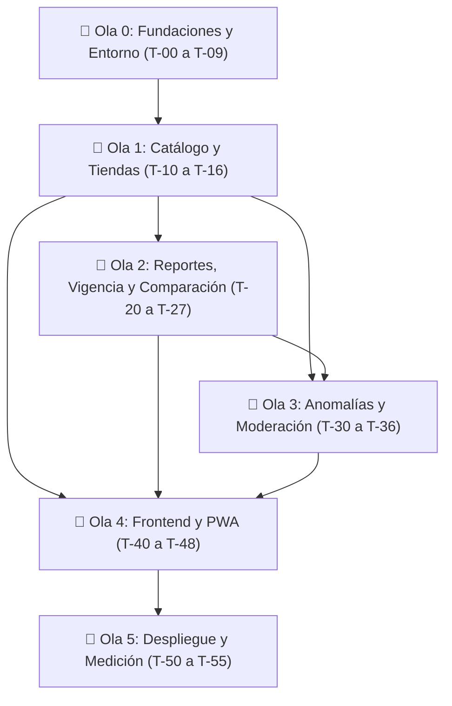

# Tasks: Núcleo del Comparador de Precios (001-nucleo-comparador)

**Feature**: Núcleo del Comparador (Etapa 1 — Olas 0 a 5: `T-00` a `T-55`)
**Spec**: [spec.md](./spec.md) | **Plan**: [plan.md](./plan.md) | **Branch**: `001-nucleo-comparador`

Este documento contiene la lista secuencial de 47 tareas atómicas de ingeniería necesarias para construir y validar el Núcleo del comparador, preservando fielmente su identificador, dependencias, responsable por rol, rutas exactas de archivos y criterio verificable «Hecho cuando…».

---

## Roles de los 4 Integrantes

* **Rol A (Arquitectura y Dominio de Precios — Líder técnico):** Esqueleto FastAPI, dominio puro de unidades, vigencia, sello y orden, módulo `precios`, caché en dos niveles, puerto `PoliticaPrecioReferencia` y ADRs.
* **Rol B (Backend de Confianza, Cuentas y Moderación):** Dominio de anomalías, riesgo y reputación, módulos `cuentas`, `confianza` y `moderacion`, fotos sin EXIF y jobs internos.
* **Rol C (Frontend Web Responsive, PWA y Usabilidad):** Esqueleto Next.js, los 15 componentes reutilizables, las 7 pantallas (`S1` a `S7`), cola offline `IndexedDB`, pruebas Playwright/`axe` y protocolo `EC-01`.
* **Rol D (Datos, DevOps y Aseguramiento de Calidad):** Entorno local reproducible con `uv` y scripts, migraciones SQL en Supabase, semilla CSV, CI/CD en GitHub Actions, despliegue con Docker en la nube, pruebas `k6` (`EC-04`), simulación `EC-03` e informes ISO/IEC 25010, 25012 y 25040.

---

## Lista de Tareas Secuenciales (Olas 0 a 5)

### Ola 0: Fundaciones, Entorno y Descubrimiento (`T-00` a `T-09`)

- [x] **T-00** | **Inicializar repositorio Git con GitHub Spec Kit (`agy`)**
  - **Depende de**: —
  - **Resp.**: **A + D**
  - **Archivos**: `.specify/`, `.agents/`, `specs/001-nucleo-comparador/`, `PROYECTO.md`, `docs/PLAN_CONSTRUCCION.md`, `AGENTS.md`, `CLAUDE.md`
  - **Hecho cuando…**: Existen los artefactos en `specs/001-nucleo-comparador/`, `git status` está limpio y `main` tiene Ruleset activo en GitHub.

- [ ] **T-01** | **Configurar entorno local reproducible sin Docker**
  - **Depende de**: `T-00`
  - **Resp.**: **D**
  - **Archivos**: `.env.example`, `scripts/dev.cmd`, `scripts/verificar_conexion.py`
  - **Hecho cuando…**: `uv venv` crea el entorno virtual, `uv pip install` instala dependencias de `pyproject.toml`, `.env.example` contiene las variables directas de Supabase y Upstash, y `python scripts/verificar_conexion.py` valida conexión a Supabase y Upstash con éxito.

- [ ] **T-02** | **Crear migración `0001_fundaciones_seguridad.sql`, script `migrar.py` y prueba de seguridad SQL**
  - **Depende de**: `T-01`
  - **Resp.**: **D**
  - **Archivos**: `supabase/migrations/0001_fundaciones_seguridad.sql`, `scripts/migrar.py`, `backend/tests/integracion/test_seguridad_bd.py`
  - **Hecho cuando…**: La migración aplica con `MIGRATIONS_DATABASE_URL`, la app conecta como `app_backend` y la prueba confirma que `anon` y `authenticated` no leen tablas.

- [ ] **T-03** | **Implementar esqueleto de FastAPI**
  - **Depende de**: `T-02`
  - **Resp.**: **A**
  - **Archivos**: `backend/pyproject.toml`, `backend/Dockerfile`, `backend/app/main.py`, `backend/app/compartido/*`, `scripts/exportar_openapi.py`, `backend/tests/integracion/test_salud_y_auth.py`
  - **Hecho cuando…**: `pytest` pasa `/v1/salud`, `/v1/salud/listo` y rechazos `401`/`403`; `Dockerfile` queda listo para el despliegue en T-50 y se exporta `docs/api/openapi.json`.

- [ ] **T-04** | **Implementar esqueleto de Next.js**
  - **Depende de**: `T-03`
  - **Resp.**: **C**
  - **Archivos**: `frontend/package.json`, `frontend/tsconfig.json`, `frontend/src/app/layout.tsx`, `frontend/src/components/AppShell.tsx`, `frontend/src/lib/api/*`
  - **Hecho cuando…**: `npm run typecheck`, `npm run lint` y `npm run build` en `frontend/` terminan con código `0`.

- [ ] **T-05** | **Redactar documentos base de ingeniería**
  - **Depende de**: `T-00`
  - **Resp.**: **A + D**
  - **Archivos**: `docs/adr/0001-*.md`..`0018-*.md`, `docs/c4/*.mmd`, `docs/PREGUNTAS_ABIERTAS.md`, `docs/DECLARACION_USO_IA.md`
  - **Hecho cuando…**: Existen los 18 ADRs, los 3 diagramas C4 en Mermaid y los registros formales.

- [ ] **T-06** | **Configurar CI en GitHub Actions**
  - **Depende de**: `T-03`, `T-04`
  - **Resp.**: **D**
  - **Archivos**: `.github/workflows/ci.yml`
  - **Hecho cuando…**: El workflow ejecuta todas las verificaciones en verde (`ruff`, `mypy --strict`, `import-linter`, `pytest` con servicios PostGIS/Redis, verificación de `openapi.json`, `npm run build` y `docker build`).

- [ ] **T-07** | **Elaborar y aplicar entrevistas/encuestas a consumidores y tiendas (Entregable 1)**
  - **Depende de**: `T-00`
  - **Resp.**: **Todos**
  - **Archivos**: `docs/calidad/entregable_1_entrevistas.md`
  - **Hecho cuando…**: Documento con instrumento, respuestas y hallazgos conectados con `EC-01` y `D-06`.

- [ ] **T-08** | **Elaborar estudio de Benchmarking de comparadores (Entregable 2)**
  - **Depende de**: `T-00`
  - **Resp.**: **D**
  - **Archivos**: `docs/calidad/entregable_2_benchmarking.md`
  - **Hecho cuando…**: Tabla comparativa y conclusiones conectadas con `D-01` a `D-04`.

- [ ] **T-09** | **Consolidar Especificación ISO/IEC 25012 (Entregable 3), Plan de Calidad ISO/IEC 25010 (Entregable 4) y matriz `trazabilidad.csv`**
  - **Depende de**: `T-07`, `T-08`
  - **Resp.**: **D**
  - **Archivos**: `docs/calidad/entregable_3_requisitos_iso25012.md`, `docs/calidad/entregable_4_plan_calidad_iso25010.md`, `docs/calidad/trazabilidad.csv`
  - **Hecho cuando…**: Entregables 3 y 4 completos y `trazabilidad.csv` vinculando cada `FR` y `EC` con su prueba.

---

### Ola 1: Catálogo Normalizado y Directorio de Establecimientos (`T-10` a `T-16`)

- [ ] **T-10** | **Desarrollar con TDD `backend/app/dominio/unidades.py`**
  - **Depende de**: `T-03`
  - **Resp.**: **A**
  - **Archivos**: `backend/app/dominio/unidades.py`, `backend/tests/unitarias/test_unidades.py`
  - **Hecho cuando…**: Pasan todos los casos de la tabla de la Sección 5.1, la propiedad con `hypothesis` y cobertura del 100 % en `unidades.py`.

- [ ] **T-11** | **Aplicar migración `0002_catalogo_establecimientos_parametros.sql`**
  - **Depende de**: `T-02`
  - **Resp.**: **D**
  - **Archivos**: `supabase/migrations/0002_catalogo_establecimientos_parametros.sql`, `backend/tests/integracion/test_migracion_0002.py`
  - **Hecho cuando…**: La migración aplica en limpio y la prueba automática verifica que existen exactamente las 43 claves de la Sección 2.4 en `config_parametro`.

- [ ] **T-12** | **Crear archivos CSV en `supabase/seed/` y script idempotente `scripts/semilla.py`**
  - **Depende de**: `T-10`, `T-11`
  - **Resp.**: **D**
  - **Archivos**: `supabase/seed/*.csv`, `scripts/semilla.py`, `backend/tests/integracion/test_semilla.py`
  - **Hecho cuando…**: Correr `python scripts/semilla.py` dos veces seguidas no duplica filas y deja el catálogo poblado (~150 productos, ~30 establecimientos de Armenia).

- [ ] **T-13** | **Implementar lectura de `catalogo`**
  - **Depende de**: `T-12`
  - **Resp.**: **A**
  - **Archivos**: `backend/app/modulos/catalogo/*`, `backend/tests/integracion/test_api_catalogo.py`
  - **Hecho cuando…**: Buscar `"arroz 1/2 kilo"` encuentra `"Arroz blanco"` con sus presentaciones en $< 300$ ms.

- [ ] **T-14** | **Implementar `establecimientos`**
  - **Depende de**: `T-12`
  - **Resp.**: **A**
  - **Archivos**: `backend/app/modulos/establecimientos/*`, `backend/tests/integracion/test_api_establecimientos.py`
  - **Hecho cuando…**: Filtra por `radio_km` y calcula `distancia_m` sin registrar `lat`/`lng` en logs; la solicitud de corrección abre caso en moderación.

- [ ] **T-15** | **Implementar endpoints de moderación de catálogo/tiendas y adaptador `open_food_facts.py`**
  - **Depende de**: `T-13`, `T-14`
  - **Resp.**: **B**
  - **Archivos**: `backend/app/puertos/catalogo_externo.py`, `backend/app/adaptadores/open_food_facts.py`, `backend/app/modulos/moderacion/*`, `backend/tests/integracion/test_moderacion_catalogo.py`
  - **Hecho cuando…**: Crear presentación calcula `cantidad_base` con `dominio.unidades`, prohíbe editar `cantidad_base` y registra en `auditoria`.

- [ ] **T-16** | **Implementar `POST /v1/sugerencias-presentacion` y su aprobación en moderación**
  - **Depende de**: `T-15`
  - **Resp.**: **B**
  - **Archivos**: `backend/app/modulos/catalogo/api.py`, `backend/tests/integracion/test_sugerencias_presentacion.py`
  - **Hecho cuando…**: Un reportante sugiere una presentación, el moderador la aprueba y nace en `presentacion`.

---

### Ola 2: Reportes, Vigencia, Caché y Comparación (`T-20` a `T-27`) — US-1, US-2

- [ ] **T-20** | **Desarrollar con TDD `vigencia.py`, `sello.py` y `orden.py`**
  - **Depende de**: `T-10`
  - **Resp.**: **A**
  - **Archivos**: `backend/app/dominio/vigencia.py`, `backend/app/dominio/sello.py`, `backend/app/dominio/orden.py`, `backend/tests/unitarias/test_vigencia_sello_orden.py`
  - **Hecho cuando…**: Pasan todas las pruebas de 5.4 y 5.5 con `RelojFalso` y `mypy --strict` limpio.

- [ ] **T-21** | **Aplicar migración `0003_cuentas_precios_moderacion_auditoria.sql` y probar inmutabilidad**
  - **Depende de**: `T-11`
  - **Resp.**: **D**
  - **Archivos**: `supabase/migrations/0003_cuentas_precios_moderacion_auditoria.sql`, `backend/tests/integracion/test_inmutabilidad_reportes.py`
  - **Hecho cuando…**: El trigger y los permisos de `app_backend` bloquean cualquier `DELETE` sobre `reporte_precio` y `auditoria` y cualquier `UPDATE` de `precio_cop`.

- [ ] **T-22** | **Implementar módulo `cuentas` y autorización Ley 1581**
  - **Depende de**: `T-03`, `T-21`
  - **Resp.**: **B**
  - **Archivos**: `backend/app/modulos/cuentas/*`, `backend/tests/integracion/test_cuentas_ley1581.py`
  - **Hecho cuando…**: Al borrar una cuenta, sus reportes quedan con `reportante_id = null`, sin fotos y con alias anonimizado.

- [ ] **T-23** | **Implementar `POST /v1/reportes` hasta el paso 4 de F2 y `GET /v1/mis-reportes`**
  - **Depende de**: `T-20`, `T-21`, `T-22`
  - **Resp.**: **A**
  - **Archivos**: `backend/app/compartido/limites.py`, `backend/app/modulos/precios/*`, `backend/tests/integracion/test_crear_reporte_idempotencia.py`
  - **Hecho cuando…**: Reintentar con la misma `Idempotency-Key` devuelve `200 OK` sin duplicar; fuera de rango da `422 PRECIO_FUERA_DE_RANGO`; exceso da `429` con `Retry-After`.

- [ ] **T-24** | **Implementar `PoliticaPrecioReferencia` (`SoloUsuarios`), recálculo transaccional y job `reconstruir_precio_vigente`**
  - **Depende de**: `T-20`, `T-23`
  - **Resp.**: **A**
  - **Archivos**: `backend/app/puertos/politica_precio.py`, `backend/app/modulos/precios/servicio.py`, `backend/tests/integracion/test_precio_vigente_equivalencia.py`
  - **Hecho cuando…**: Reconstruir `precio_vigente` desde cero produce exactamente las mismas filas y valores que el cálculo incremental.

- [ ] **T-25** | **Implementar `PuertoCache` y `cache_dos_niveles.py`**
  - **Depende de**: `T-24`
  - **Resp.**: **A**
  - **Archivos**: `backend/app/puertos/cache.py`, `backend/app/adaptadores/cache_dos_niveles.py`, `backend/tests/integracion/test_cache_comparacion.py`
  - **Hecho cuando…**: Con Redis detenido la API responde desde PostgreSQL sin error 500; jamás sirve un valor con más de 60 s.

- [ ] **T-26** | **Implementar `GET /v1/productos/{id}/comparacion`**
  - **Depende de**: `T-20`, `T-25`
  - **Resp.**: **A**
  - **Archivos**: `backend/app/modulos/precios/api.py`, `backend/tests/integracion/test_comparacion_ec06.py`
  - **Hecho cuando…**: Cumple el contrato JSON de 6.4 y pasa la prueba de neutralidad `EC-06`.

- [ ] **T-27** | **Implementar subida de fotos de prueba (`POST /v1/fotos/url-subida`) y limpieza de metadatos EXIF con Pillow**
  - **Depende de**: `T-23`
  - **Resp.**: **B**
  - **Archivos**: `backend/app/puertos/almacenamiento.py`, `backend/app/adaptadores/storage_supabase.py`, `backend/tests/unitarias/test_limpieza_exif.py`
  - **Hecho cuando…**: Una imagen con coordenadas GPS en EXIF queda sin EXIF; archivos $> \text{foto.max\_kb}$ se rechazan con `422 ARCHIVO_INVALIDO`.

---

### Ola 3: Detección de Anomalías, Reputación y Moderación (`T-30` a `T-36`) — US-3

- [ ] **T-30** | **Desarrollar con TDD `backend/app/dominio/anomalia.py`**
  - **Depende de**: `T-10`
  - **Resp.**: **B**
  - **Archivos**: `backend/app/dominio/anomalia.py`, `backend/tests/unitarias/test_anomalia.py`
  - **Hecho cuando…**: Pasan todos los casos de la tabla de la Sección 5.3 (3 niveles jerárquicos + respaldo `sin_referencia`, z-score modificado y desviación porcentual).

- [ ] **T-31** | **Desarrollar con TDD `riesgo.py` y `reputacion.py`**
  - **Depende de**: `T-30`
  - **Resp.**: **B**
  - **Archivos**: `backend/app/dominio/riesgo.py`, `backend/app/dominio/reputacion.py`, `backend/tests/unitarias/test_riesgo_reputacion.py`
  - **Hecho cuando…**: 1.000 ejecuciones iguales dan el mismo resultado; cobertura de `backend/app/dominio/` $\ge 95\%$.

- [ ] **T-32** | **Integrar evaluación completa en `POST /v1/reportes`, `huella_red` con HMAC y detección de `rafaga`**
  - **Depende de**: `T-31`, `T-23`
  - **Resp.**: **B**
  - **Archivos**: `backend/app/compartido/huella.py`, `backend/app/modulos/confianza/servicio.py`, `backend/tests/integracion/test_rafaga_y_anomalia.py`
  - **Hecho cuando…**: 3 cuentas nuevas desde la misma huella hacia una tienda en 30 min quedan todas en `dudoso`, abren caso `rafaga` y no alteran `precio_vigente`.

- [ ] **T-33** | **Implementar endpoints de moderación de casos, sanciones, apelaciones y auditoría**
  - **Depende de**: `T-32`
  - **Resp.**: **B**
  - **Archivos**: `backend/app/modulos/moderacion/*`, `backend/tests/integracion/test_flujo_moderacion.py`
  - **Hecho cuando…**: `confirmar` rechaza reporte y suma $M+1$; `descartar` acepta y recalcula `precio_vigente`; `sancionar` suspende; todo queda en `auditoria`.

- [ ] **T-34** | **Implementar jobs internos `POST /internal/jobs/{nombre}` con `X-Job-Token` y `.github/workflows/jobs.yml`**
  - **Depende de**: `T-31`, `T-24`
  - **Resp.**: **B + D**
  - **Archivos**: `backend/app/tareas/router_jobs.py`, `.github/workflows/jobs.yml`, `backend/tests/integracion/test_jobs_internos.py`
  - **Hecho cuando…**: `limpiar_huellas` anula huellas $> 30$ días y `recalcular_reputacion` actualiza perfiles correctamente.

- [ ] **T-35** | **Implementar `scripts/evaluar_ec03.py` y calibrar parámetros frente a `EC-03`**
  - **Depende de**: `T-32`
  - **Resp.**: **B + D**
  - **Archivos**: `scripts/evaluar_ec03.py`, `docs/calidad/informe_ec03.md`
  - **Hecho cuando…**: Detección individual $\ge 90\%$ (9/10), grupal $\ge 70\%$ (7/10) y falsas alarmas $\le 10\%$ (1/10).

- [ ] **T-36** | **Implementar `GET` y `PUT /v1/moderacion/parametros`**
  - **Depende de**: `T-33`
  - **Resp.**: **B**
  - **Archivos**: `backend/app/modulos/moderacion/api.py`, `backend/tests/integracion/test_parametros_negocio.py`
  - **Hecho cuando…**: Cambiar `precio.min_cop` en `config_parametro` cambia de inmediato la validación de `/v1/reportes` y audita antes/después.

---

### Ola 4: Frontend del Núcleo (`S1` a `S7`) y Usabilidad `EC-01` (`T-40` a `T-48`)

- [ ] **T-40** | **Construir `S1 (/)` Inicio con buscador, categorías, `GrillaProductos`, `TarjetaProducto` y `AvisoDatosDemo`**
  - **Depende de**: `T-04`, `T-13`
  - **Resp.**: **C**
  - **Archivos**: `frontend/src/app/page.tsx`, `frontend/src/components/TarjetaProducto.tsx`, `frontend/src/components/GrillaProductos.tsx`
  - **Hecho cuando…**: Renderiza productos y categorías reales desde la API y filtra sin errores.

- [ ] **T-41** | **Construir `S2 (/producto/[id])` con `ListaPrecios`, `FilaPrecio`, `SelloConfianza`, selector de orden y `BloquePromociones`**
  - **Depende de**: `T-26`, `T-40`
  - **Resp.**: **C**
  - **Archivos**: `frontend/src/app/producto/[id]/page.tsx`, `frontend/src/components/ListaPrecios.tsx`, `frontend/src/components/FilaPrecio.tsx`, `frontend/src/components/SelloConfianza.tsx`, `frontend/src/components/BloquePromociones.tsx`
  - **Hecho cuando…**: Muestra el orden exacto de la API en dos bloques, sellos con ícono+texto y bloque de promociones separado.

- [ ] **T-42** | **Construir `S3 (/tienda/[id])` y modal de solicitud de corrección con *honeypot***
  - **Depende de**: `T-14`, `T-41`
  - **Resp.**: **C**
  - **Archivos**: `frontend/src/app/tienda/[id]/page.tsx`
  - **Hecho cuando…**: La solicitud enviada desde la ficha crea un caso `solicitud_correccion` visible para el moderador.

- [ ] **T-43** | **Construir `S4 (/reportar)` con 3 controles, compresión WebP $\le 300$ KB, cola `IndexedDB` (Flujo F4) y modo `?medicion=1`**
  - **Depende de**: `T-23`, `T-27`, `T-40`
  - **Resp.**: **C**
  - **Archivos**: `frontend/src/app/reportar/page.tsx`, `frontend/src/components/SelectorTienda.tsx`, `frontend/src/components/SelectorPresentacion.tsx`, `frontend/src/components/CampoPrecio.tsx`, `frontend/src/lib/offline/colaReportes.ts`, `frontend/src/lib/imagen/comprimirFoto.ts`
  - **Hecho cuando…**: En modo avión guarda reporte + foto en `IndexedDB`; al volver la red sube primero la foto a la URL firmada y luego el reporte con `Idempotency-Key` sin duplicar.

- [ ] **T-44** | **Construir `S5 (/ingresar)` con Supabase Auth y aceptación obligatoria de política Ley 1581**
  - **Depende de**: `T-22`, `T-04`
  - **Resp.**: **C**
  - **Archivos**: `frontend/src/app/ingresar/page.tsx`
  - **Hecho cuando…**: Sin aceptar la política no permite reportar; guarda versión y texto en `autorizacion_datos`.

- [ ] **T-45** | **Construir `S6 (/gestion)` con `TablaGestion` para `Reportante` y `Moderador`**
  - **Depende de**: `T-33`, `T-36`, `T-44`
  - **Resp.**: **C**
  - **Archivos**: `frontend/src/app/gestion/page.tsx`, `frontend/src/components/TablaGestion.tsx`
  - **Hecho cuando…**: Un moderador resuelve un caso dudoso desde la interfaz y un reportante puede ver sus reportes y borrar su cuenta.

- [ ] **T-46** | **Construir `S7 (/legal)` y `/offline` con política Ley 1581, explicación de sellos y créditos ODbL**
  - **Depende de**: `T-05`, `T-40`
  - **Resp.**: **C**
  - **Archivos**: `frontend/src/app/legal/page.tsx`, `frontend/src/app/offline/page.tsx`
  - **Hecho cuando…**: Textos completos alineados con las Secciones 5.3 a 5.5 y atribución ODbL visible.

- [ ] **T-47** | **Configurar PWA instalable (`manifest.webmanifest`) y pasar auditoría automática WCAG 2.2 AA con `axe-core` en Playwright**
  - **Depende de**: `T-40`..`T-46`
  - **Resp.**: **C**
  - **Archivos**: `frontend/public/manifest.webmanifest`, `frontend/tests/e2e/accesibilidad.spec.ts`
  - **Hecho cuando…**: `axe-core` reporta 0 violaciones críticas o serias en las 7 pantallas.

- [ ] **T-48** | **Ejecutar prueba de usabilidad `EC-01` (10 usuarios reales, 3 intentos c/u con conexión móvil limitada) y redactar Entregable 7**
  - **Depende de**: `T-43`, `T-47`
  - **Resp.**: **C + D**
  - **Archivos**: `docs/calidad/entregable_7_usabilidad_ec01.md`
  - **Hecho cuando…**: Al menos 8 de cada 10 intentos se completan en $\le 15$ s.

---

### Ola 5: Despliegue y Medición del Núcleo (`T-50` a `T-55`)

- [ ] **T-50** | **Desplegar el núcleo de forma reproducible (Vercel, Railway con Docker, Supabase y Upstash) y activar jobs en GitHub Actions**
  - **Depende de**: `T-06`, `T-34`, `T-47`
  - **Resp.**: **D**
  - **Archivos**: `README.md`, `docs/despliegue.md`
  - **Hecho cuando…**: Sistema operativo en URL pública y job `ping_bd` respondiendo `200 OK`.

- [ ] **T-51** | **Implementar pruebas E2E en Playwright y prueba parametrizada de la Matriz de Permisos**
  - **Depende de**: `T-45`
  - **Resp.**: **B + C**
  - **Archivos**: `frontend/tests/e2e/flujos_nucleo.spec.ts`, `backend/tests/contrato/test_matriz_permisos.py`
  - **Hecho cuando…**: Los 3 flujos E2E y todas las celdas de la Matriz de Permisos 6.5 pasan en CI.

- [ ] **T-52** | **Elaborar Informe de TDD y Análisis Estático (Entregable 9)**
  - **Depende de**: `T-31`, `T-51`
  - **Resp.**: **D**
  - **Archivos**: `docs/calidad/entregable_9_tdd_analisis_estatico.md`
  - **Hecho cuando…**: Evidencia de ciclos TDD, cobertura $\ge 95\%$ en dominio y 0 hallazgos críticos en `ruff`/`mypy`/`pip-audit`.

- [ ] **T-53** | **Ejecutar prueba de carga `EC-04` con `k6` (500 usuarios concurrentes con backend local y mock en memoria / Upstash según cuota) y documentar resultados**
  - **Depende de**: `T-50`
  - **Resp.**: **D**
  - **Archivos**: `infra/k6/ec04_carga.js`, `docs/calidad/informe_ec04.md`
  - **Hecho cuando…**: $p95 \le 2000$ ms y tasa de errores $< 1\%$.

- [ ] **T-54** | **Ejecutar prueba automática de `EC-02` (100 repeticiones de cambio de precio vigente)**
  - **Depende de**: `T-25`, `T-50`
  - **Resp.**: **A**
  - **Archivos**: `backend/tests/integracion/test_ec02_actualidad.py`, `docs/calidad/informe_ec02.md`
  - **Hecho cuando…**: Peor tiempo observado en las 100 repeticiones $\le 60$ s.

- [ ] **T-55** | **Congelar núcleo con etiqueta Git `v1.0-nucleo` y entregar Documento de Arquitectura v1 (Entregables 5, 6 y 8)**
  - **Depende de**: `T-52`, `T-53`, `T-54`
  - **Resp.**: **A + D**
  - **Archivos**: `docs/entregable_5_arquitectura_v1.md`
  - **Hecho cuando…**: Etiqueta `v1.0-nucleo` creada y documento v1 completo.

---

## Dependencias y Orden de Ejecución de las Olas

---

## Resumen del Alcance del Núcleo

- **Total de tareas**: 47 tareas (`T-00` a `T-55`).
- **Completadas**: 1 (`T-00`).
- **Pendientes**: 46 (`T-01` a `T-55`).
- **Siguiente tarea ejecutable**: `T-01` (Configurar entorno local reproducible sin Docker con `uv`, `.env.example`, `scripts/dev.cmd` y `scripts/verificar_conexion.py`).
