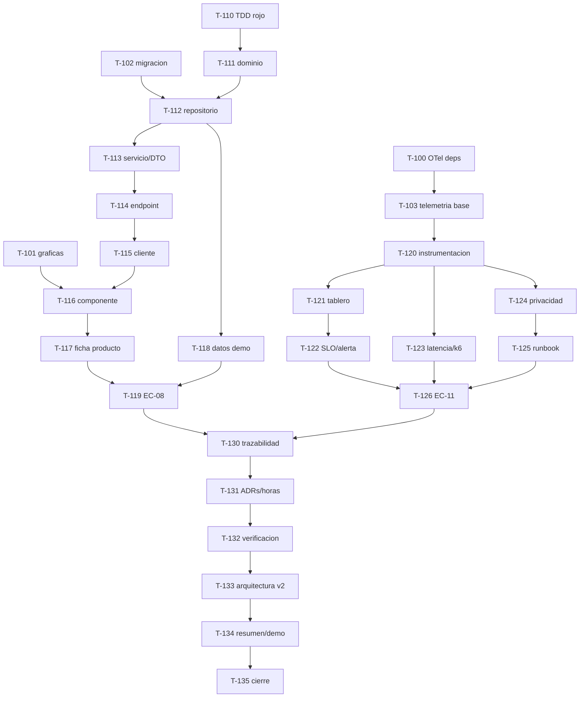

# Tasks: Ampliación Corte 3 — Historial de Precios (A2) y Observabilidad con SLO (B1)

**Feature**: `002-ampliacion-corte3`

**Spec**: [spec.md](./spec.md) | **Plan**: [plan.md](./plan.md) | **Impacto**: [impacto.md](./impacto.md)

**Prerrequisitos**: spec y ADRs aprobados; migraciones `0001` a `0003` aplicadas; módulo comercial en curso (`T-60` a `T-69`) y su migración `0004` disponible antes de aplicar `0005`.

**Convención**: IDs `T-100` en adelante para no colisionar con el núcleo (`T-00` a `T-55`) ni con el módulo comercial (`T-60` a `T-69`). `[P]` = paralelizable. `[US-A2]` / `[US-B1]` = historia.

---

## Roles

- **Rol A (Arquitectura y dominio):** dominio puro, API, contratos y ADRs.
- **Rol B (Backend de confianza y observabilidad):** instrumentación, privacidad, SLO y jobs.
- **Rol C (Frontend y accesibilidad):** gráfica, tabla alternativa, E2E y axe.
- **Rol D (Datos, DevOps y calidad):** migración, semilla, dashboards, CI y evidencias.

---

## Fase 0: Fundaciones (T-100 a T-103)

- [x] **T-100** [P] | **Configurar dependencias y variables de OpenTelemetry**
  - **Depende de**: —
  - **Resp.**: **B + D**
  - **Archivos**: `backend/pyproject.toml`, `.env.example`, `docs/despliegue.md`, `backend/app/config.py`
  - **Hecho cuando…**: `uv --directory backend sync --dev` instala el SDK/exportadores; `OTEL_SDK_DISABLED=true` deja la app operativa; las variables quedan documentadas sin secretos; `ruff`, `mypy --strict` y pruebas base pasan.

- [x] **T-101** [P] | **Agregar la librería de gráficas y el andamiaje de pruebas del frontend**
  - **Depende de**: —
  - **Resp.**: **C**
  - **Archivos**: `frontend/package.json`, `frontend/package-lock.json`, `frontend/tests/e2e/historial_precios.spec.ts` (esqueleto)
  - **Hecho cuando…**: `npm --prefix frontend run typecheck`, `lint` y `build` pasan; la gráfica se carga de forma dinámica y no rompe el build SSR.

- [x] **T-102** [P] | **Crear la migración `0005_historial_precios.sql` con el índice de la serie**
  - **Pendiente de BD**: aplicar `0005` en Supabase y correr la prueba de integración cuando exista `.env`.
  - **Depende de**: migración `0004_modulo_comercial.sql` disponible (o coordinación explícita)
  - **Resp.**: **D**
  - **Archivos**: `supabase/migrations/0005_historial_precios.sql`, `backend/tests/integracion/test_historial_precios.py` (prueba de índice)
  - **Hecho cuando…**: la migración aplica dos veces sin error; el índice `idx_reporte_historial_serie` existe; no se alteran tablas, columnas ni datos; no se edita una migración aplicada.

- [x] **T-103** [P] | **Crear el esqueleto de `compartido/telemetria.py` con configuración, sanitización y degradación**
  - **Depende de**: T-100
  - **Resp.**: **B**
  - **Archivos**: `backend/app/compartido/telemetria.py`, `backend/tests/unitarias/test_telemetria.py`
  - **Hecho cuando…**: la configuración lee variables OTLP; la lista de atributos prohibidos se aplica; `OTEL_SDK_DISABLED=true` no inicializa exportadores; un exportador caído no lanza excepción; pruebas unitarias en verde.

---

## Fase 1: US-A2 — Historial y tendencia de precios (T-110 a T-119)

- [x] **T-110** [US-A2] | **Escribir primero las pruebas TDD de `serie_precios.py` (rojo)**
  - **Depende de**: T-102
  - **Resp.**: **A**
  - **Archivos**: `backend/tests/unitarias/test_serie_precios.py`
  - **Hecho cuando…**: existen pruebas que fallan para ventana de 90 días, límites, orden, empate, origen, `aceptado`/`dudoso`/`rechazado`, `es_demo`, truncado, serie vacía y unidad `g/ml/unidad`; ninguna prueba de implementación existe todavía.

- [x] **T-111** [US-A2] | **Implementar `backend/app/dominio/serie_precios.py` (verde + refactor)**
  - **Depende de**: T-110
  - **Resp.**: **A**
  - **Archivos**: `backend/app/dominio/serie_precios.py`
  - **Hecho cuando…**: todas las pruebas de T-110 pasan; cobertura ≥ 95 %; `mypy --strict` limpio; el módulo no importa I/O, FastAPI, SQLAlchemy, Redis ni reloj del sistema; no copia campos prohibidos.

- [x] **T-112** [US-A2] | **Implementar la consulta de la serie en el repositorio**
  - **Depende de**: T-102, T-111
  - **Resp.**: **A**
  - **Archivos**: `backend/app/modulos/precios/repositorio.py`, `backend/tests/integracion/test_historial_precios.py`
  - **Hecho cuando…**: la consulta filtra por producto, establecimiento, presentación opcional y ventana; ordena por `observado_en`; excluye `rechazado`; no selecciona columnas prohibidas; usa el índice; la prueba de integración pasa.

- [x] **T-113** [US-A2] | **Implementar el servicio y los esquemas DTO del historial**
  - **Depende de**: T-112
  - **Resp.**: **A**
  - **Archivos**: `backend/app/modulos/precios/servicio_historial.py`, `backend/app/modulos/precios/esquemas.py`, `backend/tests/integracion/test_historial_precios.py`
  - **Hecho cuando…**: el servicio valida parámetros, arma la serie con el dominio puro, aplica límite/truncado y devuelve DTOs sin PII; pruebas de servicio y contrato de esquema pasan.

- [x] **T-114** [US-A2] | **Exponer `GET /v1/productos/{id}/historial-precios` y actualizar OpenAPI**
  - **Depende de**: T-113
  - **Resp.**: **A**
  - **Archivos**: `backend/app/modulos/precios/api.py`, `docs/api/openapi.json`, `backend/tests/integracion/test_historial_precios.py`
  - **Hecho cuando…**: el endpoint responde `200`, `404`, `422` y `503` según el contrato; la respuesta no tiene campos prohibidos; `scripts/exportar_openapi.py` regenera el contrato y `git diff` queda limpio.

- [x] **T-115** [US-A2] | **Agregar la llamada tipada al historial en el frontend**
  - **Depende de**: T-114
  - **Resp.**: **C**
  - **Archivos**: `frontend/src/lib/api/clienteApi.ts`, `frontend/src/lib/api/esquema.d.ts`
  - **Hecho cuando…**: `npm run gen:api` regenera los tipos; la llamada maneja `problem+json`, estados vacío/error y no calcula precios en el cliente; typecheck/lint pasan.

- [x] **T-116** [US-A2] | **Crear `GraficaHistorialPrecios` accesible**
  - **Depende de**: T-101, T-115
  - **Resp.**: **C**
  - **Archivos**: `frontend/src/components/GraficaHistorialPrecios.tsx`, pruebas de componente/E2E
  - **Hecho cuando…**: la gráfica muestra puntos por fecha, origen y estado; leyenda con patrones/íconos además de color; tabla HTML alternativa; estados de carga/vacío/error; axe sin violaciones críticas o serias.

- [x] **T-117** [US-A2] | **Integrar la gráfica en la ficha de producto**
  - **Depende de**: T-116
  - **Resp.**: **C**
  - **Archivos**: `frontend/src/app/producto/[id]/page.tsx`
  - **Hecho cuando…**: el consumidor elige establecimiento/presentación y ve la serie; el aviso de datos demo aparece cuando corresponde; no se altera el orden de comparación ni el bloque de promociones.

- [x] **T-118** [US-A2] | **Generar datos demo de 90 días y probar idempotencia**
  - **Pendiente de BD**: ejecutar el escritor contra Supabase y validar la idempotencia real; el generador y las guardas están verificados.
  - **Depende de**: T-112
  - **Resp.**: **D**
  - **Archivos**: `scripts/semilla.py` o `scripts/semilla_historial.py`, `backend/tests/integracion/test_historial_precios.py`, `supabase/seed/` si aplica
  - **Hecho cuando…**: existen series demo con `es_demo = true` en al menos 3 establecimientos; ejecutar dos veces no duplica; el aviso de demostración se activa.

- [x] **T-119** [US-A2] | **Certificar EC-08 con integración, E2E y axe**
  - **Pendiente de BD**: ejecutar la prueba de integración EC-08 contra PostgreSQL; E2E (19/19) y axe ya están certificados.
  - **Depende de**: T-114, T-117, T-118
  - **Resp.**: **C + D**
  - **Archivos**: `backend/tests/integracion/test_historial_precios.py`, `frontend/tests/e2e/historial_precios.spec.ts`, `docs/calidad/trazabilidad.csv`
  - **Hecho cuando…**: 90 días con origen y estado en el 100 % de los puntos; cambio oficial visible ≤ 60 s; `dudoso` marcado y `rechazado` excluido; 0 PII; p95 ≤ 500 ms con 100 puntos; E2E y axe en verde.

---

## Fase 2: US-B1 — Observabilidad y SLO (T-120 a T-126)

- [x] **T-120** [US-B1] | **Instrumentar registro y comparación con OpenTelemetry**
  - **Depende de**: T-103
  - **Resp.**: **B**
  - **Archivos**: `backend/app/main.py`, `backend/app/compartido/logging_cfg.py`, `backend/app/modulos/precios/servicio.py`, `backend/app/modulos/precios/servicio_comparacion.py`, `backend/tests/integracion/test_telemetria.py`
  - **Hecho cuando…**: ambos flujos generan spans y métricas; logs con `trace_id`/`span_id`; atributos permitidos; sin PII; `OTEL_SDK_DISABLED=true` no rompe nada.
  - **Fix posterior**: logging real (handler, access log saneado y puente OTLP) en commits `37fa735..04da550`, revisado y aprobado.
  - **Pendiente de colector**: validar la exportación real a OTLP/Grafana en T-126.

- [x] **T-121** [US-B1] | **Versionar el tablero de Grafana como código**
  - **Depende de**: T-120
  - **Resp.**: **D**
  - **Archivos**: `infra/observabilidad/grafana/dashboards/`, `infra/observabilidad/README.md`
  - **Hecho cuando…**: el tablero incluye tasa, p50/p95/p99, errores, caché, base de datos, SLO y presupuesto de error; se aprovisiona sin pasos manuales; el JSON es válido.
  - **Nota**: consultas alineadas con `http_target`; nombres OTel→Prometheus pendientes de validar en T-126.

- [x] **T-122** [US-B1] | **Definir el SLO y la alerta como código, y validarlos en CI**
  - **Depende de**: T-121
  - **Resp.**: **B + D**
  - **Archivos**: `infra/observabilidad/grafana/alertas/`, `.github/workflows/ci.yml`
  - **Hecho cuando…**: SLO 99 % / 7 días / presupuesto 1 %; alerta de burn rate/consumo; CI valida sintaxis; la notificación está configurada sin secretos en el repo.
  - **Nota**: validador sin red y pruebas de artefactos; sintaxis PromQL y disparo real pendientes de T-126.

- [x] **T-123** [US-B1] | **Implementar la inyección de latencia y el escenario k6 de EC-11**
  - **Depende de**: T-120
  - **Resp.**: **B + D**
  - **Archivos**: `backend/app/main.py` o middleware de pruebas, `infra/k6/ec04_carga.js`, `docs/observabilidad.md`
  - **Hecho cuando…**: `SIMULAR_LATENCIA_MS` funciona solo fuera de producción; k6 ejerce comparación; el simulacro produce latencia observable y no afecta datos.
  - **Nota**: k6 resuelve un producto real en `setup()`; el simulacro real queda para T-126.

- [x] **T-124** [US-B1] | **Probar privacidad y degradación de la telemetría**
  - **Depende de**: T-120
  - **Resp.**: **B**
  - **Archivos**: `backend/tests/integracion/test_telemetria.py`
  - **Hecho cuando…**: una prueba falla si aparece cualquier atributo prohibido; un exportador caído no afecta la API; `OTEL_SDK_DISABLED=true` funciona; no hay secretos en logs.

- [x] **T-125** [US-B1] | **Documentar el runbook de observabilidad y el despliegue**
  - **Depende de**: T-121, T-122, T-123, T-124
  - **Resp.**: **D**
  - **Archivos**: `docs/observabilidad.md`, `docs/despliegue.md`, `.env.example`
  - **Hecho cuando…**: el runbook explica tablero, SLO, alerta, simulacro, diagnóstico, muestreo, retención y reversión; las variables están documentadas; no hay secretos.
  - **Nota**: runbook alineado con el logging real; validación del colector, retención y disparo de alerta quedan para T-126.

- [ ] **T-126** [US-B1] | **Certificar EC-11 con el simulacro y la evidencia**
  - **Depende de**: T-122, T-123, T-125
  - **Resp.**: **B + D**
  - **Archivos**: `docs/calidad/informe_ec11.md` (nuevo), capturas/enlaces en el repositorio
  - **Hecho cuando…**: alerta ≤ 5 min; traza identifica el componente; tablero muestra SLO/presupuesto; evidencia reproducible; 0 PII; p95 de comparación no se degrada.
  - **BLOQUEADA — pendiente de entorno**: requiere `.env`, colector OTLP/Grafana, reglas cargadas, `k6` y un producto real del seed. La plantilla reproducible está en `docs/calidad/informe_ec11.md`; no se ha ejecutado ni certificado.

---

## Fase 3: Cierre y entregables (T-130 a T-135)

- [ ] **T-130** | **Actualizar la matriz de trazabilidad con EC-08 y EC-11**
  - **Depende de**: T-119, T-126
  - **Resp.**: **D**
  - **Archivos**: `docs/calidad/trazabilidad.csv`
  - **Hecho cuando…**: cada escenario enlaza historia, requisitos, pruebas y tareas; no quedan filas huérfanas.

- [ ] **T-131** | **Actualizar ADRs y el contraste estimado/real**
  - **Depende de**: T-119, T-126
  - **Resp.**: **A + D**
  - **Archivos**: `docs/adr/0019-historial-precios-append-only.md`, `docs/adr/0020-observabilidad-opentelemetry-slo.md`, `specs/002-ampliacion-corte3/impacto.md`
  - **Hecho cuando…**: los ADRs pasan a `Aceptado`; la columna de horas reales está completa; se documentan desviaciones, riesgos y trade-offs.

- [ ] **T-132** | **Ejecutar la verificación completa y corregir regresiones**
  - **Depende de**: T-130, T-131
  - **Resp.**: **Todos**
  - **Archivos**: `backend/tests/`, `frontend/tests/`, `docs/calidad/`
  - **Hecho cuando…**: `pytest` (unitarias, integración y contrato), `ruff`, `mypy --strict`, `import-linter`, `typecheck`, `lint`, `build`, Playwright/axe y k6 pasan; no hay regresiones en EC-01 a EC-06.

- [ ] **T-133** | **Agregar la sección de la ampliación a la arquitectura v2**
  - **Depende de**: T-132
  - **Resp.**: **A + D**
  - **Archivos**: `docs/entregable_10_arquitectura_v2.md` (coordinar con `T-69`) o documento equivalente
  - **Hecho cuando…**: se documentan A2/B1, sus ADRs, el impacto en el núcleo, los escenarios EC-08/EC-11 y el contraste estimado/real de los dos cambios.

- [ ] **T-134** | **Preparar la subsección del documento resumen y el guion de demo**
  - **Depende de**: T-132
  - **Resp.**: **Todos**
  - **Archivos**: documento resumen del corte 3 y guion de sustentación (según la guía del curso)
  - **Hecho cuando…**: hay una subsección de la ampliación con la decisión arquitectónica más relevante y su evaluación; el guion demuestra A2 y B1 en vivo.

- [ ] **T-135** | **Revisión final y cierre de la rama**
  - **Depende de**: T-133, T-134
  - **Resp.**: **A + D**
  - **Archivos**: `specs/002-ampliacion-corte3/tasks.md`, `docs/calidad/`
  - **Hecho cuando…**: todas las tareas están marcadas; `git status` limpio; la rama está lista para revisión/merge; se registran las lecciones y pendientes.

---

## Dependencias y orden

## Dependencias externas

- **T-63 (módulo comercial):** debe conservar el historial del precio oficial en `reporte_precio` con `fuente='comercio'` (`ADR-0019`). Sin esto, A2 no puede certificar el origen oficial.
- **PA-05:** confirmar el endpoint/cuotas de observabilidad antes de T-122.
- **PA-06:** confirmar el mapeo de entregables antes de T-133/T-134.
- **Migración 0004:** debe existir antes de aplicar `0005`.

## Resumen

- **Total de tareas:** 27 (`T-100` a `T-135`, con rangos).
- **A2:** 10 tareas.
- **B1:** 7 tareas.
- **Fundaciones:** 4 tareas.
- **Cierre:** 6 tareas.
- **MVP A2:** T-110 a T-119.
- **MVP B1:** T-120 a T-126.
- **Regla:** mínimo antes que extensión; las extensiones opcionales (comparar dos establecimientos, segundo SLO de EC-02) se abordan solo después de certificar los mínimos.
